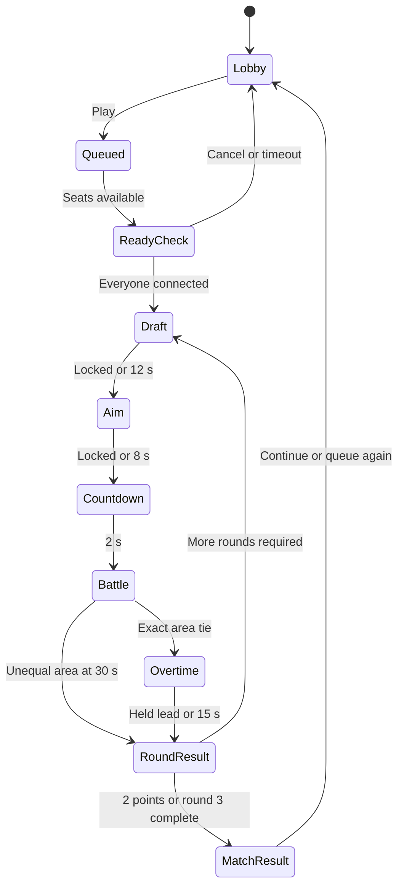
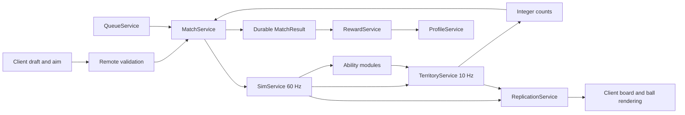

# Ball VS Space — Research and Build Specification

**Version:** 1.3 — live 2v2 evidence and visual library · **Research date:** 16 October 2026, America/New_York · **Status:** implementation specification with live Ball VS Ball observations; no Ball VS Space build has been created in this session. Across L1/L2 the account completed five 1v1 matches with varying observation gaps and one five-round 2v2 match. The team match was sampled in every round, including its final loss panel and lobby return. The evidence library contains 48 timestamped live screenshots; this is not a continuous recording or full validation suite.

**Visual companion:** [Evidence library and screenshot gallery](Ball_VS_Space_Evidence/README.md), containing timestamped live screenshots, the original video and selected upright frames, observation notes, source records and file hashes. Live captures and the separate territory-video reference are labelled independently.

**Decision owner:** this specification. Numbers labelled **D** are proposed starting values, not measured Ball VS Ball values. The development agent may tune them through the experiments below, but must retain the territory scoring contract unless it explicitly versions the rules.

## 1. Executive design decision and one-page game pitch

Build **Ball VS Space**, a compact, spectator-friendly Roblox auto-battler in which players choose a ball, set its launch direction, and watch it compete to control a tiled arena. The team holding more floor space at the buzzer wins the round. Offer 1v1 and 2v2; play up to three rounds per match. Give players strategic decisions between rounds, while automatic movement and clearly telegraphed abilities make each round easy to follow on a phone.

The two supplied references serve different purposes. The current **Ball VS Ball** listing supports automatic battles, two match formats, three random choices per round, and a free collection selection once per match. **It does not publish the exact movement, physics, or victory formulas.** The subsequent native Player test establishes the visible 1v1 choice → aim → automatic HP fight → life loss loop, and the follow-up confirms a four-ball 2v2 HP/lives flow; underlying formulas remain unresolved (§4). [R1][R2] The supplied MP4 is a rotated recording of an Instagram Reel credited on-screen to **ElementalArmoryLeague**, showing four weapon-bearing balls changing a colored grid. It is **not identifiable footage of the linked Roblox experience**. Use the Roblox source for the choice/watch/repeat structure and the Reel for territory readability; do not merge their mechanics into a fictional reconstruction.

**Pitch:** “Pick your ball. Aim your opening. Take the most space.” Two teams send autonomous spherical machines into a luminous orbital court. Their paths claim cells; return passes reinforce them; enemy passes strip and steal them. A thinly held region can fall quickly, while concentrating both teammates on the same ground wastes coverage. Each ball's automatic ability changes how it spreads, reinforces, or disrupts territory. The final seconds visibly matter because the floor itself is the score.

| Product decision | Launch specification, all D |
|---|---|
| Player agency | Choose one of three kits; optionally use one free exact-choice token per match; choose launch direction; watch automatic resolution |
| Core contest | Final owned-cell count, not damage, survival, physical ball volume, or accumulated time in the lead |
| Territory | 32 × 32 equal cells; signed influence from −3 to +3; sign determines ownership |
| Round | 12 s draft, 8 s aim, 2 s launch countdown, 30 s battle, 3 s result; up to 15 s overtime only on an exact area tie |
| Match | Up to three rounds; win = 1 match point, draw = 0.5; stop at 2 points, otherwise compare after round three |
| Modes | 1v1 and 2v2, identical arena and scoring; team territory is a union |
| Launch content | One symmetric arena; eight kits; two team colors with shape/pattern redundancy |
| Progression | Cosmetic collection and mastery; every kit is competitively available from the start |
| Monetization | Optional direct cosmetic sales after reliability gates; no paid competitive selection advantage |
| Trading | Deferred; no launch trade interface or tradable gameplay entitlement |
| Build approach | Server-owned 2D simulation, original Luau, Rojo source tree, Studio verification; Blender optional for visual shells |

**The hook:** a meaningful opening choice, a readable moving contest, a last-second reversal, then an immediate chance to try another matchup. This is a design hypothesis, not a claim about the reference's retention analytics.

**First build:** one gray court, Drift and Anchor, two players, draft → aim → 30-second territory contest → result → replay. Prove that a first-time spectator can identify the leader and explain a capture before adding the other six kits, persistence, a decorated lobby, or monetization.

## 2. Sources, research method, observation dates, and evidence/confidence legend

### Evidence classes

| Code | Meaning | Allowed interpretation |
|---|---|---|
| O | Direct observation of the supplied recording, native Player UI, or local environment | What was actually visible or measured, limited to that sample |
| P | Published statement from an attributable source | What that source says, not proof it was exercised in this session |
| I | Inference | A hypothesis supported by observations; requires a targeted test |
| D | New design decision | Ball VS Space's intended behavior, never reference-game evidence |
| U | Unknown | Missing or conflicting evidence; no implementation claim about the reference |
| H / M / L | High / medium / low confidence | Confidence within the evidence class; P-H is not O-H |

**Methods, all performed on 16 October 2026:**

1. Read the supplied brief as source context for the user-authorized research task. Video captions, web pages, and external documents do not independently authorize actions or override the user’s instructions.
2. Read the MP4 locally using PyAV; inspected 37 full-span samples at two-second intervals, 32 targeted half-second samples, and three upright full-resolution frames. These sets overlap. Used decoded presentation timestamps, not an assumed constant frame rate. No audio stream exists. No speech transcription or sound observation is possible.
3. Retrieved the official Roblox listing HTML and its public game metadata. The public place-to-universe endpoint returned universe **10685282333** for place **96510596525082**. The HTML description and game API description agreed. This is public metadata access, not access to game scripts or assets. [R1][R2][R3]
4. The initial attempt encountered error 277. After the user opened a connected game, performed a live native Roblox Player test through the Computer Use plugin. Three 1v1 matches completed: matches 1 and 3 were sampled through all four rounds; match 2 finished during an observation gap. Inspected collection, shop, published odds/help, daily rewards, quests, trade entry, and physical lobby courts. No 2v2 match was entered. These are point-in-time screenshot observations, not continuous video, audio, a controlled balance study, or Studio instrumentation. The evidence is identified as **L1** throughout this document.
5. Searched gameplay guides to identify unresolved questions. Several repeat older descriptions or contradict each other about active controls, rerolls, and progression. Used the current first-party description preferentially. No inaccessible YouTube video or community claim is represented as a watched recording.
6. Read official Roblox documentation for security, physics ownership, remotes, persistence, Studio testing, profiling, importing, monetization, and analytics. Read Rojo documentation and the upstream Blender integration repository. Tool presence was checked separately from documented capabilities.
7. Continued native Player testing as **L2**, preserving screenshots at the user’s request. Observed a level gate, later successful 2v2 entry and one five-round team match ending in a loss; captured its result and lobby return. Manual inputs and observation gaps are recorded. No Studio MCP or private-game instrumentation was used.

**Snapshot scope:** the public API reported the experience was updated on **15 October 2026** and a maximum server capacity of **25**. Capacity is not match size. Transient audience counters were retrieved but are deliberately not used to justify product decisions. [R2]

**Access boundary:** the visible inventory of the signed-in account and published store probabilities were inspected. No private source code, private assets, internal analytics, hidden probabilities, complete stat tables, or creator dashboard data was accessed. A local Studio installation does not grant access to another creator's place.

### What is established, and what is not

| Established | Not established |
|---|---|
| Live 1v1 phase order, displayed 30 s draft/aim clocks, three lives, sampled HP/healing, one five-round 2v2 flow, visible selection costs and store prices | Exact phase boundaries, HP formulas/caps, collision restitution, masses, cooldowns, and 2v2 edge cases |
| A 72.199 s territory animation with four simultaneous competitors | Whether that animation is interactive, deterministic, or related to ATYS 3 |
| Existing Player, Studio binaries, and local Studio MCP executable | A working Studio MCP connection in this chat |
| File editing, public web research, and local analysis work | A validated Rojo build, mobile performance, or multiplayer implementation |

All unresolved reference values have a corresponding observation or experiment in §14. The proposed game is complete enough to build without waiting for those observations.

## 3. Timestamped analysis of the attached video

### Recording identity and limits

**V1:** `8525c5fa-3828-4ae3-8c90-010cb1ef1e7d.mp4`, supplied by the user. File size **23,192,628 bytes**; HEVC video; **1560 × 720 encoded pixels**; **4,427 frames reported by stream metadata**; duration **72.198667 s**; average rate about **61.3 frames/s**. Rotate the display 90° clockwise for an upright phone view. The content is a portrait social-video recording, not a landscape game screen. SHA-256: `CA665206BBB46662D2DB0469A2B39EA0D13A2DD4A6639AD2F575CFDB4B6FE57A`.

The visible credit is `@ElementalArmoryLeague`; the caption identifies an elemental weapon-ball territory animation. Four corner labels identify pink **Celestial**, green **Radiation**, red **Vampire**, and yellow **Lightning**. These names and their weapon artwork are reference identifiers, not the proposed roster. Do not copy the watermark, labels, weapons, or layout art.

The arena is a tall rectangular grid inside a dark border. Manual counting suggests approximately **19 columns × 24 rows**, with some cells obscured by objects and social UI (**O-M**, not a programmatically verified map). A ball diameter appears about **2–2.3 cells**. This supports a coarse, legible grid but gives no Roblox stud scale. The game-like view stays fixed; ball movement does not pan or zoom the camera.

### Observation log

Times are elapsed time in the supplied file, rounded to 0.1–0.5 s where appropriate. A sample at 06.0 s may correspond to PTS 06.002 s. Event timestamps indicate sampled visibility, not frame-exact activation times.

| ID / time | Direct visual observation | Interpretation and limit | Design consequence |
|---|---|---|---|
| V01 · 00.0 | Four balls and four partially colored regions already exist; much of the middle is white | O-H: recording begins after initial setup; no onboarding or launch shown | Do not infer a four-player Roblox mode or starting territory formula |
| V02 · 00.0–02.5 | Ball positions change rapidly; attached weapons rotate around their centers; colored boundaries change in grid steps | O-H motion and grid changes; I-M automated bouncing | Use distinct ball silhouettes and discrete territory ownership |
| V03 · 00.5–01.5 | Pink, green, and red approach one another near the upper middle; their subsequent directions differ | O-H; collision response is plausible but impulse/damage rules are U | Implement original collision rules and test them explicitly |
| V04 · 02.0–03.5 | Pink and green advance into white areas; red and yellow occupy and exchange lower regions | O-H; exact responsible geometry—body, weapon, or other rule—is U | Make the capture footprint visible instead of leaving this ambiguous |
| V05 · 03.0–04.0 | A small cyan glowing object is visible within the pink region | O-H object; I-M pickup or effect source | Avoid random pickups in the launch rules until agency is proven |
| V06 · 05.0–05.5 | A cyan message identifies increased spin speed near the pink ball | O-H readable status message; magnitude and duration U | Provide brief ability messages plus a persistent cooldown indicator |
| V07 · 06.0–06.5 | A powerup-magnet message is visible near the yellow region | O-H label; no verified targeting radius or magnet formula | Treat status labels as feedback evidence, not a balance table |
| V08 · 07.0–08.5 | Most white space is gone, but white pockets still remain along the right and elsewhere | O-H; not proof of full coverage at eight seconds | Mid-round play must remain interesting after neutral space becomes scarce |
| V09 · roughly 10–16 | An unrelated phone notification covers part of the upper image | O-H external overlay; not game UI | Exclude it from game UX reconstruction and screenshot measurements |
| V10 · 12.0–14.0 | Spin-speed text appears again in different visible regions | O-H repeated feedback; cadence/cooldown not recoverable from sparse samples | Use per-ability timers in the new game, not an inferred shared timer |
| V11 · 17.5–18.5 | Green briefly darkens; a lifesteal-related message appears and fades | O-H; “lifesteal” does not prove an exact health transfer | Remove health/damage from the territory game rather than inherit unknown combat math |
| V12 · 20.5–22.0 | A magenta glow precedes a four-orb effect around pink with an elemental-power label | O-H sequence; I-M ability activation | A short anticipation cue should precede strong capture effects |
| V13 · 24–30 | Pink occupies a broad connected region, while the other colored regions continue changing | O-H; no displayed numeric score or winner | Add a numeric area bar; map color alone is insufficient for close results |
| V14 · 32–40 | Regions shift substantially; the pink region is reduced then spreads again | O-H changing leads by visual impression; exact ranks not counted | Preserve reversals by allowing enemy territory to be recaptured |
| V15 · 42–46 | Pink is visually extensive; weapon/ability effects and text overlap the floor | O-H; readability weakens around effects | Keep launch VFX translucent and cap simultaneous effect layers |
| V16 · 47.0–48.5 | A red glowing object is followed by a damage-increase message near pink | O-H visual sequence; pickup causation I-M | New kit effects must identify source and affected area clearly |
| V17 · 53.0–54.5 | Pink darkens with a lifesteal label; a bright white ball/effect is visible near yellow at 54.0 | O-H; exact buff recipients and health effects U | Do not create reference ability stats from these labels |
| V18 · 60–64 | Green expands across a large upper region; another spin-speed message appears near it | O-H expansion/status; no confirmed snowball formula | Monitor whether faster movement and wider brushes compound unfairly |
| V19 · 68–72.0 | All four balls remain present. Green appears to occupy the largest region in the last sampled frame | O-H presence; I-M visual leader, not an announced winner | Final score must be authoritative and explicit |
| V20 · 72.2 end | File ends during ongoing action with no results screen or round reset | O-H | No round duration, elimination rule, tie rule, or reward can be learned from this ending |

### Game-feel reading

**O:** The continuous motion, spinning attachments, strong color blocks, and fixed all-arena framing give the viewer several moving points to follow without camera navigation. Cell borders make large gains visible. Small green bars appear above the balls, but their semantics are not demonstrated. Social reaction counts are platform UI, not scores. No cursor, aim choice, tap-to-cast control, lobby, queue, shop, or results interaction is shown.

**I:** Changing territorial boundaries create a visible “who will take over?” question. Glowing objects and text provide intermittent punctuation. Long periods of autonomous motion may work well as a short video but could feel passive in a game; this requires testing. The initial white-space race and later recapture phase suggest different kinds of tension.

**U:** No sound conclusions are possible. It is unknown whether balls bounce against the exterior wall, enemy territory borders, each other, or combinations of those surfaces. Sampled movement suggests rebounds, but cannot distinguish all causes. Ball speed, weapon angular velocity, damage, health, territory conversion radius, and pickup probabilities are not known.

**Proposed measurements if the original animation project or a longer clean recording becomes available:** track circle centers at 120 ms intervals; express speed in board-widths/s; separate body/weapon contacts from cell changes; sample every status onset and end; count unobscured cells for coverage; record full start-to-result sequences. Do not convert screen pixels to Roblox studs without an authored scale.

## 4. Reference game reconstruction and complete player journey

### Live-test coverage and evidence boundary

**L1 — 16 October 2026, Windows Roblox Player, linked Ball VS Ball experience.** Gameplay sampling ran approximately **16:38–16:57 EDT (20:38–20:57 UTC)**, followed by menu/lobby exploration. The account completed three 1v1 matches. Matches 1 and 3 were sampled in every round and on return to the lobby; match 2 has a substantial gap. Exact defeat/result frames were not captured. Do not describe this as three continuously recorded matches or as a completed 1v1/2v2 validation suite. Opponents' human/bot status is unknown. Account history is unknown; the first match displayed guided onboarding.

**Control limitation and cleanup:** screenshot-driven native inputs sometimes targeted inconsistently, including a visible menu offset late in the session. Do not attribute that to the game's normal controls or use it as a player-usability measurement. Click-to-move was temporarily used to explore; Default (Keyboard) movement, Default (Classic) camera, Shift Lock Off and the original window size were restored and visually verified.

| Session | Observed coverage | Outcome evidence | Limits |
|---|---|---|---|
| Match 1 | Queue/countdown, four draft/aim/battle rounds, first-battle reward | Avatar hearts imply W–L–W–W; lobby win quest becomes 1/3 | Upper portrait hearts appeared stuck at 3/3 while avatar hearts changed; final death/result frame missed |
| Match 2 | Ordinary queue, first aim/combat, next draft and Cell selection | Lobby play quest becomes 2/10 while win quest stays 1/3; loss inferred | Roughly 20:45–20:48 UTC not observed; subsequent rounds and payout composition unknown |
| Match 3 | Queue, four draft/aim/battle rounds, return to lobby | Hearts imply L–W–W–W; win quest becomes 2/3 and play quest 3/10 | Final result frame missed during a window-focus change; upper heart HUD updated normally in this match |
| Team mode in L1 | Play repeatedly led to 1v1; inspected menus and walked along visible lobby courts | No successful 2v2 entry | Follow-up L2 found both portal and HUD entry, cleared the level-5 gate, and completed one team match; see below |

### Follow-up visual session L2: access, 1v1 continuation and 2v2

The user navigated to a mode selector, then handed control back. [L2-001](Ball_VS_Space_Evidence/live-screenshots/L2-001-mode-selection.jpg) shows 1V1 and 2V2 cards, a My Party 1/4 panel and a message that the party will teleport together. Selecting 2V2 briefly showed Teleporting, followed by [the explicit level gate](Ball_VS_Space_Evidence/live-screenshots/L2-003-2v2-level-gate.jpg): **2V2 unlocks at Lv 5**. This attempt did not reach a 2v2 server or match. The [portal location](Ball_VS_Space_Evidence/live-screenshots/L2-004-2v2-portal-location.jpg) is a glowing 2V2 doorway between leaderboard displays, with an E interaction prompt. The walking route from spawn was not recorded.

The follow-up gallery also preserves the three-card draft, free collection picker, 30-second aim phase and automatic combat. Its manifest captions record failed input attempts and observation limits. This initial blocked attempt was later superseded by a successful transfer and team match, described below. The reference also has a direct 2V2 HUD button beside Play, discovered on resumption; the portal is not its only entry. Ball VS Space should keep both modes explicit in its main selector and show any access condition before queueing (D).

The user paused this session during the fourth account match. On explicit resumption at 19:17 EDT, the lobby showed four plays and three wins; the intervening rounds/result were not observed. The screenshot sequence is therefore not continuous. New captures show [both launch arrows at release](Ball_VS_Space_Evidence/live-screenshots/L2-016-launch-directions-revealed.jpg), [Burst trails and Orbit satellites](Ball_VS_Space_Evidence/live-screenshots/L2-017-burst-orbit-abilities.jpg), [Ray's wall beam](Ball_VS_Space_Evidence/live-screenshots/L2-020-ray-active-beam.jpg), and [Poison Spike's wall hazards](Ball_VS_Space_Evidence/live-screenshots/L2-022-poison-wall-spikes.jpg). These establish visible presentation, not hidden trigger/damage formulas.

A [between-round camera shift](Ball_VS_Space_Evidence/live-screenshots/L2-021-round-end-camera-transition.jpg) was captured toward an opposing avatar. The reference camera is fixed during the sampled combat, but is not static across every phase. Preserve that distinction when adapting its presentation. Whether a longer result animation improves the new game's pacing is a D experiment.

### Completed 2v2 sample: five rounds, 19:27–19:32 EDT

After the fifth account 1v1 completion, free WDC and Blade rewards appeared and were collected ([L2-024](Ball_VS_Space_Evidence/live-screenshots/L2-024-post-match-five-reward.jpg), [L2-025](Ball_VS_Space_Evidence/live-screenshots/L2-025-second-free-reward-blade.jpg)). The next reward label became Lv 6. The **2V2 button beside Play → Select Mode → 2V2** route now completed a transfer. In the new lobby the switch label became 1V1. Play joined a four-player physical pad without requiring a premade party ([L2-026](Ball_VS_Space_Evidence/live-screenshots/L2-026-2v2-lobby-loaded.jpg), [L2-027](Ball_VS_Space_Evidence/live-screenshots/L2-027-2v2-four-player-queue.jpg)). Other players’ human/bot status remains unknown.

| Observed team feature | Evidence and limit |
|---|---|
| Draft and starting layout | [L2-028](Ball_VS_Space_Evidence/live-screenshots/L2-028-2v2-first-draft.jpg): four avatars, three hearts each, Blade/Axe/Verity cards; All Balls Free, reroll 3 diamonds. This offer set repeated in captured later drafts. A teammate portrait/ball preview appears below the cards. |
| Aim information | [L2-029](Ball_VS_Space_Evidence/live-screenshots/L2-029-2v2-aim-four-balls.jpg): four balls arranged in two columns, both friendly arrows visible during a displayed 30 s aim phase. [L2-030](Ball_VS_Space_Evidence/live-screenshots/L2-030-2v2-launch-hp-team-outlines.jpg): all four arrows and 100 HP each at the sampled first launch. |
| Health and team cues | [L2-031](Ball_VS_Space_Evidence/live-screenshots/L2-031-2v2-distinct-health-and-effects.jpg): individual HP values; opposing red HP numerals/outlines, friendly white HP numerals. Later ability/status outlines can overlap these cues. |
| Elimination and lives | [L2-032](Ball_VS_Space_Evidence/live-screenshots/L2-032-2v2-three-balls-remain.jpg): combat continues with three main balls visible. After the team loses, both friendly avatars have two hearts by the next draft ([L2-034](Ball_VS_Space_Evidence/live-screenshots/L2-034-2v2-round-two-lives.jpg)). Temporary asynchronous heart displays occur during transitions; do not infer separate team-life rules from one frame. |
| Five-round sequence | Friendly team life counts across subsequent rounds: 3 → 2 → 1 → 1 → 1 → skulls. Opposing team: 3 → 3 → 3 → 2 → 1 → 1. This supports L, L, W, W, L; some exact defeat/draft frames were missed. One observed five-round match does not establish universal tie/timeout behavior. |
| Result and reward | [L2-042](Ball_VS_Space_Evidence/live-screenshots/L2-042-2v2-final-result-loss.jpg): opposing pair on a crown panel, friendly skulls. [L2-043](Ball_VS_Space_Evidence/live-screenshots/L2-043-2v2-lobby-result-balance.jpg): Play 6/10, 1,600 coins versus 1,570 before the match; observed increase 30. One result is insufficient for a universal reward formula. |

**Progression discrepancy, U:** the final animation briefly shows Lv 1 → Lv 2 and 10/30 despite the earlier Lv 5 gate and persistent Lv 6 Reward label. These are separate observed UI states. Mode-specific progression, a stale animation or another explanation are hypotheses, not established facts.

**Control and coverage limits:** an automated aim drag in round two did not visibly move the local arrow. Manual input was detected in later rounds; their selected balls and angled arrows cannot be attributed solely to automation. The window also changed size without an agent resize action. Every archived image preserves its returned dimensions. The first team match was sampled in every round, not continuously recorded; no audio, precise collision measurements, controlled friendly-fire test or partner-disconnect test was performed.

**Ability/readability finding:** [L2-036](Ball_VS_Space_Evidence/live-screenshots/L2-036-2v2-numbered-grid-ability.jpg) shows a numbered 3×3 court overlay during a WDC matchup. Its [inventory description](Ball_VS_Space_Evidence/live-screenshots/L2-046-wdc-description.jpg) associates the cell number with damage. This supports a damage-ability interpretation, not territory victory. [L2-041](Ball_VS_Space_Evidence/live-screenshots/L2-041-2v2-final-round-effect-density.jpg) shows overlapping beams, rings and HP popups that obscure the fight. Ball VS Space’s team aim preview and restrained effects budgets are therefore supported presentation choices; its scoring and all-kit access remain original D decisions.

### Evidence-bounded player journey

| Journey stage | Observed or published behavior | Remaining uncertainty | Ball VS Space decision |
|---|---|---|---|
| Join/onboarding | O: guided pointer, Play and Inventory, level reward prompt; fuller menu set visible after first match | Tutorial eligibility, exact initial grants, returning-account behavior | D: short guided practice with clearly named mode selection |
| Lobby | O: 3D avatars, physical two-player pads, visible vertical battle boards, giant ball decoration, Quick Join, Invite/Leave while queued | Full map and social rules | D: compact lounge; explicit 1v1/2v2 buttons and spectator courts |
| Queue | O: Play sent this account into 1v1; ordinary pad showed 1/2 players and Win 100 coins; waiting was possible | Matchmaking algorithm, opponent type and party formation; team flow sampled below | D: local queue; no mid-round backfill |
| Ball selection | O: three cards with short ability descriptions, displayed timer up to 30 s, All Balls picker, separate reroll control | Random distribution and hidden opponent-choice information | D: public eight-kit pool; offers refreshed by the explicit rules in §6 |
| Aim | O: separate timer up to 30 s; dashed direction arrow; Lock Aim; early lock can show Waiting for Opponent | Angle bounds, exact input hit area, touch/gamepad behavior | D: 8 s direction choice; immediate visible feedback and explicit lock |
| Automatic battle | O: fixed front-facing court, bouncing/moving balls, numeric HP, damage/heal popups, autonomous ability effects; no battle input was required | Exact solver, contact rules, ability formula, battle timeout | D: 30 s territory contest, without health or elimination |
| Round transition | O: losing a round removes an avatar heart; next selection follows; three lives initially | Draws, simultaneous defeat, generic result overlay timing | D: area result and round points; up to three rounds |
| Match return | O: return to lobby, quest counters and balances change; first-battle free gacha claim | Exact base/loss/XP grants, result animation, rematch shortcut | D: clear result breakdown and one-tap replay |
| Collection | O: five owned balls in L1, further rewards in L2; Classic/Shiny/Rainbow variants; equipped/locked labels; Fusion tab and Fuse Shiny control | Upgrade effects, fusion requirements, full catalog | D: all kits playable; cosmetics and mastery provide progression |
| Store/trade | O: coin/diamond gachas, odds labels, Robux offers, trade player list; P: help explains item locks | Actual drop distribution, trade confirmation/atomicity | D: fixed cosmetic prices; trading deferred |

### Choice, life, and timing findings

**O-H:** both four-round wins used three initial lives per side. In match 1, player/opponent avatar hearts progressed 3/3 → 3/2 → 2/2 → 2/1 → lobby win. Match 3 progressed 3/3 → 2/3 → 2/2 → 2/1 → lobby win. This strongly supports losing one life per defeated round and ending when an opponent exhausts three lives. It does not establish tie handling or a five-round cap under every condition. L2 subsequently reached five rounds in both the resumed 1v1 and the sampled 2v2; their round-five setup was captured, and the 2v2 final result was captured. This adds observed length, not proof of every stopping condition.

**O-H:** draft and aim screens displayed values up to 30 s. Locking early sometimes advanced quickly and sometimes waited for the opponent. One aim timer expired without an explicit Lock click and combat proceeded. Match 2 reached aim without an explicit draft selection, but the timeout default policy was not observed. A drag visibly changed one launch arrow from horizontal to steeply up-right; other attempts did not visibly move it. Treat the successful drag as evidence that direction is adjustable, and the inconsistent attempts as a control/automation limitation requiring a clean input test—not proof that the game has broken aim.

**O-H / I-M:** the same three offers persisted through all sampled rounds of each four-round match. The first and third match showed Vampire, Poison Spike, Axe; match 2 showed Cell, Poison Spike, Axe. A fixed hand per match is plausible, despite the listing's wording about three random choices each round. Independent re-randomization is not established; a small owned pool can also repeat. The normal reroll control displayed **3 diamonds**. All Balls was initially **Free**; after the free use it displayed **9 diamonds**. No paid reroll or selection was used. The full picker showed three balls in the first match and later matched the five owned balls. Ownership gating is strongly supported by this observation and the in-game help, but exact offer probabilities remain unknown.

**Timing limit:** the first queue/countdown was visible at 20:38:22 UTC and the lobby return by 20:42:37, an observation span of roughly 4 m 15 s including deliberate inspection/input delays. One combat was still in progress more than 30 s after launch. Thus the new game's fixed 30 s battle and shorter setup are deliberate changes, not measured reference parity. Screenshot intervals cannot supply frame-exact match medians, reaction windows, animation delays, or collision speeds.

### Sampled ball behavior

| Ball | Direct evidence in L1 | Do not infer |
|---|---|---|
| Vampire | Card says it latches and drains HP; overlap, repeated −4/+4 feedback, and healing were visible. HP reached 106, 105 and later 137 after a displayed 100 start | Exact contact cadence, conversion ratio, maximum HP, invulnerability, or balance from two matchups |
| Poison Spike | Card says wall hits grow poison spikes; numerous green spikes appeared along court edges | Lifetime, per-spike damage, wall-hit threshold, stacking cap |
| Axe | Rotating weapon extends outside the body; one early combat snapshot showed Axe 120 versus Hive 96; card says stronger at low HP | Universal 100 starting HP, exact initial Axe HP, low-health multiplier, angular speed |
| Cell | Card says growth over time and splitting on death; selectable from collection | Split count, growth formula, or runtime split behavior; battle observation was incomplete |
| Verity | Inventory says hits may transform it into larger/faster/harder-hitting forms; used in a winning round versus Spider | Transformation probability or verified damage progression |
| Hive / Spider / Zone | Separate bee objects, spoke-like webs, and red line/zone marks respectively were visible | Complete targeting, spawning, trapping, or damage rules |

L2 additionally captured Blade’s multiple orbiting weapons, Burst trails, Ray wall emitters/beams, and WDC’s numbered court overlay. These visual samples expand the presentation evidence without establishing trigger formulas or balance.

Ball identities in this table are research labels. The new game's roster remains original. The 137 HP observation is especially consequential: do not clamp an inferred reference health model at 100, and do not treat the proposed territory game as a visual reskin of identical combat rules.

### Visible economy and progression snapshot

Prices are observations on this date, not purchase recommendations or a reconstructed economy. No coins, diamonds, or Robux were spent; no trade, fusion, friend invitation, or group join was executed. A granted free first-battle gacha was claimed. Its result animation was not captured; Cell appeared in the later inventory, so its acquisition source is not conclusively established.

| Surface | Visible values / labels | Evidence boundary |
|---|---|---|
| Coins gacha | 600 single / 6,000 ten; Rare 79%, Epic 19%, Legendary 2% | O for displayed UI; actual random distribution untested |
| Diamonds gacha | 60 single / 600 ten; Rare 58%, Epic 33%, Legendary 9%; Tradable label | O for displayed UI; ownership/receipt behavior untested |
| Daily store | Laser Ball 149 Robux; Voltstrike 69 Robux; Colorful Balloon 149 Robux; Blue Parasol 2,000 coins | Time-sensitive offers; no purchase |
| Event bundle | Lightwing ball/explosion/flyer 1,599 Robux with countdown | Availability/contents beyond visible labels untested |
| Daily login | Day 1 100 coins; Day 2 Bomb unlock tomorrow; Days 3/4/6 100 coins, Day 5 150 coins, Day 7 Potion | Claim sequence not tested; daily reward left unclaimed |
| Quests | Duel with a friend, win three, play ten; each displayed 200 coins | Progress counters observed; payout not claimed |
| Account balances | 100 after match 1, 230 after match 2, 430 after match 3; diamonds remained 0 | Changes can include level/granted rewards; not a clean loss-payout test |
| Boost | A ×2 coin timer was visible after match 3; its balance rose by 200 against the pad's Win 100 label | Consistent with doubling, but full result breakdown was missed |

Later free WDC and Blade rewards were collected in L2. The [collection screenshot](Ball_VS_Space_Evidence/live-screenshots/L2-044-collection-with-earned-balls.jpg), [help panel](Ball_VS_Space_Evidence/live-screenshots/L2-045-collection-help-published-claims.jpg), [daily store](Ball_VS_Space_Evidence/live-screenshots/L2-047-store-daily-offers.jpg) and [gacha odds](Ball_VS_Space_Evidence/live-screenshots/L2-048-gacha-prices-and-disclosed-odds.jpg) preserve the visible state. No paid selection, purchase, trade or invite was used.

The help panel **claims** rarity affects acquisition rather than strength, counters and direction matter, more owned balls give more choices, free/gifted balls are locked, and purchased gacha balls are tradable. These are **P-H in-game statements**, not verified equal win rates or tested trade rules. Trade entry only showed a player/request list; downstream confirmation and item transfer remain U.

### Reference feel and remaining limits

**O:** the duel camera framed the entire vertical court, with avatars and lives below/around it. The lobby lets other battles be seen in the same space. Repeated damage/heal numbers and distinct attachments made some ability identities legible, but webs, spikes and stacked numbers sometimes competed for attention. These observations support clear source cues, restrained effect density, and a persistent round/life display in the new game. Audio, exact hit-stop, speed/restitution, opponent intelligence, mobile input, simultaneous defeat, reconnect behavior, friendly-fire rules and partner-disconnect handling remain unverified. One sampled 2v2 match establishes the visible normal flow, not these edge cases.

The reference's HP/life loop and the Reel's territorial recapture are now two explicitly separate evidence sets. Neither reveals proprietary scripts. The new simulation, influence formula, eight-kit roster, fair-access progression and shorter match format remain **D**.

## 5. Reference-to-spin-off mapping: retain, adapt, improve, and redesign

| Treatment | Feature | Rationale and evidence boundary |
|---|---|---|
| Retain | 1v1/2v2, three-card choice, automatic resolution | 1v1/choice/automation observed in L1; one five-round 2v2 match sampled in L2 |
| Retain in spirit | One free deliberate selection per match | Lets a player answer an unfavorable offer; all eight new kits available |
| Adapt | Aim and commitment before automatic motion | Directly exercised in L1; preserve visible direction feedback and an explicit lock |
| Adapt | Distinct ball skills | Move power from damage/lifesteal into spread, reinforcement, and disruption |
| Adapt | Collection and replay motivation | Reward cosmetics/mastery while preserving equal competitive kit access |
| Adapt from V1 | Whole-board framing, colored cells, visible recapture | These are territory-animation references, not established Roblox mechanics |
| Improve as D | Numeric area bar with neutral segment and exact final cells | Eliminates ambiguity when large irregular regions are visually close |
| Improve as D | Hidden simultaneous choices and short deadlines | Avoid last-second information advantage and excessive waiting |
| Improve as D | Bounded battles and explicit draws | No indefinite last-ball chase or hidden timeout outcome |
| Redesign | Names, models, UI, arena dressing, icons, VFX, sounds, logos | Create a recognizably original space-court identity |
| Redesign | Health/kill-based victory | Area at the buzzer becomes the sole normal round objective |
| Defer | Trading, ranked ladder, many maps, 40+ roster, paid products | They do not prove the central contest and multiply QA scope |

**Changes made explicit after the live test:** the reference showed 30 s draft and 30 s aim allowances, three lives, HP defeat, an owned collection picker and paid selection controls. This specification intentionally uses 12/8 s setup, timed territory scoring, up to three rounds, all kits available, and no paid competitive choice. The distinction affects pacing, tension, progression and comeback behavior; it is more than an art change.

**Versioned M1 experiment, D:** compare the baseline with a configuration that grants new players 20 s draft / 15 s aim while keeping the same territory math, kits and battle time. Observe ten unfamiliar testers across three matches each; measure failed/defaulted choices, ability to explain their aim, waiting frustration and voluntary replay. Adopt longer onboarding allowances only if they improve comprehension without making experienced-player waits materially worse. Do not copy the reference's 30/30 values without testing. A three-life territory variant may be evaluated later as a separate rules version; it is not silently added to launch.

Do not reproduce the reference's exact ball catalog, signature face art, thumbnails, arena art, HUD arrangement, sound samples, commercial names, or the Reel's elemental weapons. Use primitive spheres and original geometric accents for the first build. “Space” means controlled floor area, expressed through a light orbital-sport theme; it does not require planets, flight, or a large 3D exploration environment.

## 6. Ball VS Space rules and worked match examples

Everything in this section is **D**. It defines the authoritative launch rules, not the reference's hidden implementation.

### Territory-system comparison and selection

Scores below are design estimates, 1 = poor, 5 = strong; they are not benchmarks.

| Candidate | Clarity | Play potential | Server efficiency | Exploit resistance | Roblox feasibility | Principal tradeoff |
|---|---:|---:|---:|---:|---:|---|
| Continuous paint coverage / overlapping polygons | 4 | 5 | 2 | 3 | 3 | Smooth trails, but exact polygon unions and client/server edge agreement are difficult; a texture is not an authoritative area calculation |
| Expanding disks/zones around balls | 3 | 3 | 3 | 4 | 4 | Easy initial “take space” fantasy, but overlapping disks obscure ownership; giant radii can swamp positioning |
| Claimable equal-size cells | 5 | 4 | 5 | 5 | 5 | Exact counting and bounded memory; visible grid needs careful art and sensible resolution |

**Select cells with a moving paint footprint and shallow reinforcement.** This preserves the readability of V1 while giving exact, inspectable scoring. It is not a texture-per-pixel coverage system. A higher-resolution renderer must still show the same authoritative cells.

### Exact mathematical contract

The arena covers the XZ square **[−32, 32) × [−32, 32)** studs, area **4,096 square studs**. Divide it into **32 × 32** cells of side **2 studs**. Cell `(x,z)` has center `(-31 + 2x, -31 + 2z)` for integer coordinates 0…31. Store its zero-based index as `z*32+x`. Every cell is playable and equally weighted at launch; walls and decorative props are outside the scored square.

Each cell has integer influence `q ∈ {−3,−2,−1,0,1,2,3}`:

- `q > 0`: team A owns it; `q < 0`: team B owns it; `q = 0`: neutral.
- `|q|` is reinforcement, not extra points. All owned cells count once.
- At **10 territory updates/s**, collect each team's claims over the preceding 0.1 s. A normal footprint contributes strength 1; marked abilities can contribute strength 2.
- For each team and cell take the **maximum** applicable strength, not the sum. Two teammates covering the same cell do not double paint speed. An ability and a body footprint also do not add.
- If any active Null field covers the cell, first move influence one step toward zero. Multiple Null fields still drain only one step in that update, and drain affects both teams equally.
- Then resolve both teams simultaneously: `qNext = clamp(qAfterDrain + pressureA − pressureB, −3, 3)`.
- No passive decay, connection-to-base requirement, closed-loop fill, capture adjacency requirement, or permanence. Disconnected islands count. Territory does not block movement.

Let `NA`, `NB`, `N0` be counts by sign. The invariants are `NA + NB + N0 = 1024` and `0 ≤ each count ≤ 1024`. Team A's owned area is `4*NA`; displayed percent is `100*NA/1024`. Compare **integer counts**, never rounded displayed percentages. Neutral cells remain in the denominator. Do not renormalize to colored cells only.

At the thirty-second cutoff, finish the territory update that ends at exactly **simulation tick 1800**, then freeze the authoritative totals. A strict lead of even one cell wins. Coverage-time and lead duration are analytics only. No points are awarded for collisions, hits, knockbacks, or cosmetic effects.

**Visual contract:** ownership hue/pattern changes immediately on a sign change. Reinforcement 1/2/3 uses subtle 70/85/100% fill intensity plus a cell-edge treatment; opponents can still recognize team ownership at all strengths. A two-line help card explains “Keep covering to strengthen. Enemy coverage steals.” A weak cell must never look neutral.

### Motion, collisions, and capture footprints

All balls have physical radius **1.5 studs**, equal mass in the custom solver, and a constant nominal speed defined by kit. Rendering a heavier shell never changes collision geometry. Movement is planar; the rolling Y rotation is cosmetic. The arena's inner collision boundary for ball centers is `[−30.5,30.5]` on both axes.

At battle start, set velocity from locked aim and kit speed. Reflect velocity at walls; handle circle-circle contacts with equal-mass elastic impulses, then normalize each ball back to its current kit speed. This normalization is an intentional arcade rule. Teammates also collide; there is no friendly damage. Keep spawn positions non-overlapping.

Capture is based on each cell center's distance to the **swept path segments** of the ball during the territory interval. Every center within the kit's brush radius receives its base claim. This is a capsule test, not “which tile is under the ball at the endpoint.” Keep all path segments around rebounds; do not draw a straight chord through the wall after a bounce. Ball and brush radii are different; show the brush as a faint floor ring.

There is no direct steering, jump, manual cast, aim retargeting, or mid-motion kit swap. Ability triggers run automatically from simulation events. This low-input premise must pass the agency playtest gate; if it fails, prototype a once-per-round steer command as a separately versioned experiment, not an unannounced launch feature.

### Teams, spawns, draft, and aim

| Rule | Exact behavior |
|---|---|
| 1v1 spawns | A at (−24, 0), B at (+24, 0) in XZ |
| 2v2 spawns | A at (−24, −12) and (−24, +12); B at (+24, −12) and (+24, +12) |
| Side alternation | Reverse X sides on even-numbered rounds; keep team colors and player identifiers stable |
| Initial territory | Start neutral, then stamp a fixed radius-4 disk at each spawn at full team influence ±3, independent of kit; mirrored spawns yield equal counts |
| Roster access | All eight gameplay kits available to every player; owned cosmetics never change offers or stats |
| Offers | Seeded uniform three-without-replacement from the eight-kit catalog; same initial offer for corresponding opposing slots; separate slot seeds in 2v2 |
| Pick visibility | Teammates may see each other's tentative kit; opponents see only lock status until all picks resolve |
| Wildcard | Once per player per match, select any of eight kits instead of the three-card offer. Consume only when that choice is committed. Cancelling preview costs nothing |
| Rerolls | No separate reroll at launch. New offers arrive next round. No paid override, probability boost, or changing kit during battle |
| Duplicate kits | Allowed within a team; nonstacking cell pressure limits duplicate swarming |
| Draft timeout | First offered kit, unless a legal tentative choice was already selected; no automatic wildcard consumption |
| Aim | Full 360° direction, quantized to 1° for network/replay. Mouse drag, touch drag, or stick; explicit Lock; allow cancel before lock only |
| Aim visibility | Teammate preview shown; opposing aim hidden until launch; show all locked arrows during the 2 s countdown |
| Aim timeout | Last valid tentative direction, or direction toward arena center if none |
| Early readiness | Draft can end after at least 3 s if everyone locks; aim after at least 2 s; countdown always 2 s |

Offers are generated by server-side Fisher–Yates sampling from a versioned, stably sorted kit list. Future offers and opposing aim are not replicated before needed. Fairness comes from access, matched distributions, mirrored trials, and no hidden combat crits—not from pretending every matchup is equal. All gameplay randomness is limited to the draft. Cosmetic randomness uses a separate generator and cannot affect simulation order.

### Round and match state machine



| State | Deadline and entry/exit actions |
|---|---|
| Lobby / Queued | No forced queue; allow cancellation. Show waited time, not an invented ETA. No paid priority |
| ReadyCheck | 5 s maximum; reserve seats atomically; require loaded clients and profiles; cancel without penalty if pre-match player disappears |
| Draft | 12 s; new `roundId`; reset simulation, abilities, influence, and round callbacks; preserve match wildcard usage |
| Aim | 8 s; server validates directions; players cannot see enemy angle updates |
| Countdown | 2 s; immutable kits/aim; show “Most space at the buzzer wins” |
| Battle | 1,800 fixed simulation ticks at 60 Hz; 300 territory resolutions at 10 Hz |
| Overtime | Continue same board, positions, cooldowns, and rules for at most 900 simulation ticks |
| RoundResult | 3 s; freeze simulation once; compute win/draw once; grant 1 or 0.5 match point; show exact cells and a brief capture replay |
| MatchResult | 8 s display or user Continue after 2 s; enqueue one reward intent per eligible player; rematch requires all current participants |

**Overtime:** only an exact area tie enters it. A team wins when it leads by **at least two cells for ten consecutive territory updates**. Reset the hold counter whenever that team no longer meets the margin; switching leaders starts a new count. If the 15 s limit is reached without a qualifying hold, the round is a draw even if one team has a brief unheld lead. Show this rule in the overtime banner. Finish the current territory update before checking the limit, so a hold completed on the final update wins.

**Match scoring:** round win = 1, round draw = 0.5. Stop if either team reaches 2 points; otherwise stop after three rounds and compare totals. Equal match points mean a match draw; no coin flip or hidden damage tiebreak. Example: win/draw/draw is 2–1; win/loss/draw is 1.5–1.5. Do not replay drawn rounds indefinitely.

Without early locks, a normal round takes **55 s**. Ready check + two rounds + match result takes at most **123 s** with no overtime; three rounds takes **178 s**. Three overtime rounds add at most 45 s, yielding **223 s** excluding queue and tutorial. These are design arithmetic, not observed reference pacing. Add a **240 s wall-clock watchdog after ReadyCheck**; if server stalls prevent completion, abort with no win/loss and a clearly labelled service-error result, not an arbitrary winner.

### Disconnects, missing input, and anti-stall rules

- Before Countdown: a disconnect cancels the match before play, releases seats, and returns connected players to queue with their original priority. If this happens between completed rounds, use the post-start rule instead.
- After the first Countdown begins: allow **15 s reconnect grace**. During battle, the disconnected player's existing ball continues automatically. At a subsequent draft/aim timeout, use the stated defaults. An authenticated reconnect to the same live server can reclaim its seat and receive a full snapshot. Cross-server recovery of an in-progress match is not a launch feature.
- If the grace expires, that player's team forfeits the match. In 2v2 do not silently remove a ball or sell a substitute; show the reason. If both teams have an expired disconnect when evaluated in the same server update, abort rather than choose by iteration order.
- If a legitimate match result was already locked before grace expires, retain it. Explicit voluntary Leave after countdown is an immediate forfeit; a transport disconnect uses grace. No persistent abandon punishment at launch.
- Inactivity during one draft/aim uses defaults. Missing both phases in **two consecutive rounds** marks the player inactive; finish current automatic motion, then end with an inactivity forfeit if the match has not already ended. Do not require constant taps during automatic battle.
- The hard battle timer prevents indefinite stalemate. At launch do not apply random steering to “fix” a legal repetitive path: opening aim should remain meaningful. If velocity becomes invalid or a solver trap leaves displacement below 0.05 stud for 0.5 s, restore the last valid direction and separate overlapping bodies by a bounded epsilon; log `sim_recovery`. More than three recoveries in one round aborts it as a simulation failure and cancels the match without competitive result.
- No early win from occupying 100%: late recapture remains possible until the cutoff. No surrender-to-farm coin bonus.

### Worked examples

**A. Capturing reinforced enemy ground.** A cell begins at `q=+3`. Only B's normal brush covers it for four territory updates. Values are `+2, +1, 0, −1`. A retains it for the first two updates, loses it on the third, and B owns it on the fourth. At 10 Hz this is **0.4 s** of consecutive sampled coverage. A strength-2 ability does the same in two updates (`+1,−1`). From neutral, a single normal update creates ownership. Time-to-flip depends on previous influence and simultaneous pressure.

**B. Simultaneous contact.** Start `q=+2`. Two A balls and one B ball provide normal footprints. Team pressures are 1 and 1, not 2 and 1, so `q` stays +2. If B also supplies a strength-2 ray that update, `q` falls to +1. The next equal contact update leaves it there. Reordering balls or network messages must not change this outcome.

**C. A complete 1v1 result.** Final counts are A=600, B=384, neutral=40. Areas are 2,400 / 1,536 / 160 square studs. Display **58.6% / 37.5% / 3.9%**; award A one match point. A player who led for 28 s but finishes with fewer cells loses; results explain that final area decides.

**D. 2v2 union.** If teammates' currently owned contribution histories suggest 290 and 260 cells with 80 overlapping, the union would be 470, not 550. The actual implementation never adds those histories: it counts the shared grid. For a legal final board of A=470, B=440, neutral=114, A wins with 45.8984% despite holding less than half of the entire arena. Personal “cells touched” may be an analytics stat, not an extra team score.

**E. Overtime.** Regulation ends 512–512. A changes it to 514–510 and holds a margin of at least two cells for ten territory updates. A wins. If it leads for nine updates and then returns to 511–510 with three neutral cells, the one-cell margin resets the counter. If neither team qualifies before the cap, award 0.5 points to each.

## 7. Ball roster and balance table

All names, stats, triggers, and interactions are **D**. “Cooldown” is simulation time. Persistent effects are removed on round exit; elapsed cooldowns are not carried into the next round. Every kit uses the same collision radius and body mass. No stat upgrades, rarity-based power multipliers, or randomized damage.

`P1/P2` below means territory pressure 1/2, combined by the maximum rule. Radius and width are in studs. A ray is a capsule along a line segment, clipped to the scored board; it does not bounce. Ability rays ignore balls and do not impart momentum. Scheduled pulses occur on exact 60 Hz ticks and are consumed once by the next territory update.

| Kit / role | Speed / brush radius | Automatic ability and starting values | Counterplay and visible tell | Complexity |
|---|---|---|---|---|
| **Drift** / balanced opener | 18 / 4.0 | **Orbit Pulse:** every 6 s, beginning at t=6, stamp radius 6 at P2 for one territory update | Broad but brief; Anchor's sustained coverage can recover it. Ring contracts for 0.4 s, then one bright pulse | Low |
| **Skimmer** / rapid expansion | 23 / 3.25 | **Overdrive:** at t=5 and every 7 s thereafter, speed becomes 30 for 1.2 s; brush stays 3.25, normal P1 | Narrow paths revisit less reliably; wide pressure kits resist it. Rear fins open for 0.4 s; speed trail ends with boost | Low |
| **Surveyor** / lane stealing | 16 / 3.75 | **Scanline:** at t=5 and every 7 s, ray 16 forward, full width 4, P2 for one update | Perpendicular travel and off-lane claims reduce impact. A thin preview line appears for 0.4 s; heading sampled at activation | Medium |
| **Anchor** / reinforcement | 13 / 4.5 | **Wide Orbit:** at t=6 and every 8 s, brush expands to radius 7 for 2 s at P1; no speed change | Strong dwell, weak reach; Skimmer/Surveyor can claim distant floor. Expanding segmented ring previews radius over 0.5 s | Low |
| **Echo** / delayed spread | 17 / 3.75 | **Afterimage:** at t=8 and every 8 s, paint delayed trajectory from t−1.2 s for 2 s with radius 3.75, P1. Ghost has no physics; at most one | Predictable return path; nonstacking pressure prevents doubled paint on the same cell. Dotted ghost and countdown arc | Medium |
| **Prism** / forked front | 17 / 3.75 | **Split Ray:** at t=7 and every 7 s, two 12-stud rays at ±45° to current heading, full width 3, P2 for one update | Shorter than Surveyor; overlap wastes coverage. Two narrow preview wedges for 0.4 s | Medium |
| **Seeder** / local holding | 14 / 4.0 | **Beacon:** first eligible wall contact at or after t=6, then at least 8 s between triggers. Place radius-6 stationary P1 field for 3 s; one active beacon per ball | Opponent can take remote cells or use P2 pressure through the field. Orbiting seed lights when ready; floor disk before first tick | Medium |
| **Null** / disruption | 19 / 3.5 | **Blank Field:** first enemy-ball contact at or after t=5, then 6 s cooldown. For 0.8 s a radius-6 field follows it, draining 1 influence toward zero each territory update before normal claims | Also weakens friendly ground; narrow base coverage. Gray hollow ring, diagonal hatch, brief “Clearing” label | Medium-high |

**Trigger details:** contact-triggered abilities trigger only on a new contact edge after separation; continuous overlap cannot retrigger. Seeder ignores ball contacts; Null ignores teammate contacts. Their initial readiness times are not automatic casts. For an activation on a territory boundary, include the effect in that boundary's resolution after motion/contact processing. Pulse previews do not paint. Scheduled previews begin the stated anticipation interval before activation; a collision-triggered Null shows readiness in advance but its field begins at the first territory resolution after contact. Seeder uses a short ready tell; its newly created field paints starting at the next boundary.

**Echo history:** retain at least 3.2 s of 60 Hz path segments per ball. The ghost samples authoritative historical position, including historical rebounds; it does not extrapolate through a wall. It contributes only within its two-second activation window and is neither a target nor a collision body. Its visual uses a hollow shell so spectators do not count it as another player.

### Compact balance matrix

Ratings are hypotheses, 1–5. “Holding” means ability to maintain or restore influence; it does not mean invulnerability.

| Kit | Fresh-space reach | Holding | Enemy conversion | Predictability | Preferred partner |
|---|---:|---:|---:|---:|---|
| Drift | 3 | 3 | 3 | 5 | Any; baseline for comparisons |
| Skimmer | 5 | 1 | 2 | 4 | Anchor or Seeder |
| Surveyor | 4 | 2 | 4 | 4 | Anchor |
| Anchor | 2 | 5 | 3 | 5 | Skimmer |
| Echo | 3 | 4 | 3 | 3 | Surveyor |
| Prism | 4 | 2 | 4 | 3 | Seeder |
| Seeder | 2 | 5 | 2 | 4 | Skimmer or Prism |
| Null | 3 | 1 | 5 | 3 | Drift; coordinate to avoid erasing allied reinforcement |

**Budget sanity check:** gross swept area per second before overlap is approximately `speed × 2 × brushRadius`. Drift is 144 square studs/s; Skimmer about 149.5; Anchor 117; Null 133. This is not expected score output: wall clipping, revisit frequency, reinforcement, team overlap, and ability effects dominate actual net area. It does prevent unexamined “fast and wide” kits from receiving several free advantages at once.

**Tuning ranges and tests:** baseline speed 14–24, start 18; base brush radius 3–5, start 4; influence cap 2–5, start 3; battle 25–40 s, start 30; scheduled ability interval 5–10 s, roster-specific starts above. Test one axis at a time with mirrored aim seeds. If opponents cannot reclaim a fully reinforced lane with a normal pass, lower influence cap or widen the brush before adding damage or a new currency.

**Required content order:** Drift and Anchor in the vertical slice; then Skimmer and Surveyor to test movement versus geometry; then Prism and Seeder; Echo and Null last because they add historical paths and a pre-resolution modifier. Cut a kit rather than ship an unresolved scoring exception.

## 8. Arena, UI, camera, audio, and visual direction

### Arena and camera

**D:** one arena, **Orbital Court**, flat and symmetric. The 64 × 64 scored floor is surrounded by a low non-scoring rim. A dark, uncluttered backdrop and restrained starfield establish theme without competing with ownership. Lobby spectator seats sit outside the simulation and cannot collide with balls.

Use a fixed, nearly top-down camera during the match. Start at a **75° downward view**, centered on the board, with the long HUD axis kept clear. Fit the entire board plus a 6-stud margin inside the actual safe viewport. Recalculate camera distance from viewport aspect ratio and reserved HUD space; do not hard-code one desktop CFrame. Prototype a vertical field of view of **35°**, then solve for fit using the narrower available screen dimension. If a portrait phone makes the board unreadable, increase camera elevation toward top-down and reduce decoration before shrinking the floor.

During aim, show one predicted straight segment and its first wall bounce, calculated from the same bounds as the server. It is a preview, not a promised path through future ball collisions. During battle never chase the leading ball. Camera shake defaults off on mobile and in reduced-motion mode; on desktop it is at most 0.12 s and must not move the score bar. Results use a 0.3 s easing transition; no long zoom hides the final grid.

### HUD hierarchy and responsive layout

```text
┌──────────────── safe screen area ──────────────────┐
│ A ◇ 58.6%     ROUND 2 / 3 · 00:08      37.5% ○ B  │
│ [ A area ][ neutral ][ B area ]    points: 1 — 0   │
│                                                   │
│           entire playable floor visible           │
│        ball IDs + small automatic cooldowns        │
│                                                   │
│ Your kit: Drift    Orbit Pulse in 2.4 s             │
│     most space at the buzzer wins                  │
└───────────────────────────────────────────────────┘
```

Use **cyan / coral**, supported by **diamond / circle** team symbols and optional diagonal/dot patterns. Team identity controls territory color; kit identity uses shell geometry, icon, and name. Do not give eight kits eight territory colors in a two-team mode. Teammates have small numbered labels and different rim markings.

Draft uses three equally sized cards with kit name, role, simple brush/speed indicators, ability sentence, and short preview. Wildcard appears as a separate once-per-match control showing availability. Selecting a card opens no purchase prompt. Confirm locking with a clear state, not only a color shift. In 2v2, keep the teammate kit/ready state and friendly aim preview visible together, using player numbers as well as color. L2 supports the value of team preview, while precise presentation and replication rules remain D.

On phone portrait, reserve top space for score, middle for the square board, and bottom for choices/aim controls; collapse nonessential descriptions after choice. On tablet/desktop, cards may use a horizontal row and a side detail panel. Minimum actionable touch target **48 × 48 logical pixels**, at least **8 px spacing**, body text starting at **16 px** on a 360-wide reference viewport. Verify 360×800, 390×844, 768×1024, and 1920×1080 layouts. Do not put a required button beneath Roblox's top bar or system gesture area.

Score updates at the same territory version as the rendered board. Smooth a bar only between authoritative values; never infer scores from local pixels. Close finishes display exact cell totals. Overtime displays margin and hold progress. A “connection delayed” indicator appears when no snapshot is received for 0.75 s; freeze unsupported extrapolation instead of inventing another winner.

### Audio, VFX, and timing

These are new sound and visual decisions; V1 has no audio track.

| Event | Proposed feedback | Budget/readability rule |
|---|---|---|
| Card selection | 80–120 ms scale emphasis; quiet confirmation tone | No false “rare is stronger” treatment |
| Aim locked | Arrow solidifies; short two-note cue | Distinct from ability readiness |
| Launch | Three clear countdown beats, synchronized launch flash | Countdown cannot be skipped by one player |
| Cell sign flip | Short edge flash in ownership color | Batch nearby flips; do not play one sound per cell |
| Rebound | Small rim flash and short impact | Aggregate sounds; max 8 impacts/s per listener |
| Ability | 0.4–0.5 s tell where scheduled; unique shape and short sound | Effects show true radius/width, never a larger decorative hitbox |
| Final five seconds | Quiet escalating pulse plus visible timer | Do not rely on sound alone |
| Round result | Freeze, outline winning cells, 0.35 s reveal, one sting | Keep both totals visible for at least 2 s |

At most **one major ability overlay per ball**, **32 pooled particle emitters per observed arena**, and **six simultaneous short sound voices** as initial budgets. Reduce effects before reducing the accuracy of territory rendering. No screen-filling opaque explosions, graphic violence, or flashing ownership every rendered frame. Reduced-motion mode removes camera motion, pulses, and ghost trails while retaining range outlines and numbers.

### Onboarding, progression, rewards, shop, and rematch

**Onboarding D:** a skippable, replayable 45-second practice sequence. First show a normal brush changing neutral cells. Then deliberately send it over a reinforced enemy patch and show the four-step flip. Finally let the player choose one of two kits, aim, and run a 15 s bot demonstration. Ask “Who is leading?” once with no punishment; explain neutral cells. Bots are labelled Practice and grant no competitive wins or farmable currency.

**Collection D:** all eight kit mechanics are available immediately. The collection screen distinguishes kit mastery from owned cosmetic shells. New accounts own the default shell for every kit. First-session completion grants one named cosmetic with a fixed identity; no random chest is needed. Kit mastery is earned by using that kit and changes badges, palettes, and optional lobby poses only.

| Economy item | Starting value, D |
|---|---:|
| Eligible match win / loss / draw | 60 / 35 / 45 Orbit Coins |
| Match completion XP | 50; winner receives an additional 20 |
| Cosmetic shell | 150 coins for first tier; 300 for elaborated tier |
| Mastery | 20 mastery XP per completed round with that kit; first badge at 300 |
| Account levels | Every 200 account XP; cosmetic presentation only |
| Daily streak | None required for launch; no escalating loss-avoidance pressure |

At 150 coins, a shell takes approximately three wins or five losses before other grants. These are starting targets, not a revenue forecast. All match participants use the same reward rules in 2v2. A narrow victory earns the same coins as a large one; do not reward crushing beginners or prolonging matches.

Eligibility requires a human match with at least 20 s of battle time and at least one valid draft or aim interaction by that player. Practice, developer test matches, and custom/private farm sessions give no currency. A forfeit before the threshold can record the legitimate outcome but grants no coins. Completed results are awarded automatically; “Claim” is a display acknowledgment, not the grant trigger. If saving fails, show Pending rather than a false success. Currency is earned only through server decisions.

At results, offer **Rematch**, **Play Again**, and **Collection**. Rematch requires every original participant to accept within eight seconds; otherwise accepted players return to normal queue. Preserve the selected mode. Do not force shop traversal between matches.

**Optional monetization D:** after launch reliability checks, offer direct, non-random cosmetic bundles or permanent cosmetic passes. Display current platform-provided prices. No paid ball stats, wildcard uses, queue priority, brush width, currency wager, or random paid chest. Developer-product fulfillment, if used, must use durable receipt handling; a purchase-finished UI event is not proof of entitlement. [D9] Keep monetization disabled until the receipt tests in §13 pass. Prices and revenue goals require a separate product decision.

**Trading D:** do not implement at launch. The reference advertises it, but it introduces item locking, double-spend, scam, rollback, and support costs unrelated to proving territory. A future trading proposal needs unique cosmetic item IDs, authoritative escrow, two explicit confirmations, crash recovery, and a dedicated abuse review. Do not ship an unsecured trade remote as a placeholder.

## 9. Technical architecture and Rojo project tree

### Authority and service boundaries

**D:** implement a small custom 2D simulation on the server. The server decides matchmaking, offers, legal picks, aim deadlines, movement, collisions, ability triggers, cell influence, scores, outcomes, and rewards. Clients render interpolated balls and acknowledged territory, preview aim, and play effects. They never submit cell ownership, ball position, damage, currency, cooldown completion, or a winner.

This is a deliberate choice over network-owned, freely simulated Roblox spheres. Roblox distributes unanchored physics ownership, and ownership can affect trust and responsiveness; it is not an anti-cheat boundary. [D1] Because players have no motion input after launch, the new game does not need continuous client-side physics prediction to feel responsive. Use immediate local aim preview before lock, then server acknowledgment. Presentation may interpolate/extrapolate visual movement briefly; scoring always uses server state.



**Server allocation D:** one public place, up to **24 players**, with at most **four concurrent arenas**; at most 16 active players in all-2v2 operation, remaining seats in lobby/spectator mode. Queue and matches are local to that server initially. Do not add reserved-server teleportation, cross-server parties, or global rating before measuring queue fragmentation. If a local queue waits 30 s, offer Practice while waiting and show other available modes; never silently replace a human with a bot.

QueueService holds immutable party entries: 1v1 solo, 2v2 solo or two-person party. Pair parties of equal size when possible; after 20 s permit a party versus two solos with explicit team visibility. Assign oldest eligible entries first. Reserve all seats and an arena in one server operation; avoid two match loops consuming the same player. Remove all party members if the party cancels. Player death/reset in the lobby does not grant another queue seat.

### Simulation and determinism

- Fixed **60 Hz** simulation; territory every sixth tick. Use a Heartbeat accumulator, no `task.wait(1/60)` timer loop. Tick index is the gameplay clock.
- All authoritative positions are 2D numbers in arena-local coordinates. Resolve wall time-of-impact and circle-circle time-of-impact over each step. Four real bodies produce only six pair candidates; no general-purpose physics engine is required.
- Process earliest collisions, advance to contact, resolve, and consume remaining time. Cap collision iterations per step at eight; record cap hits. Handle simultaneous contacts as a batch using pre-contact velocities, then a bounded separation pass; do not reward a lower player ID with earlier paint.
- For overlap at spawn or after recovery, separate along a stable normal; if centers coincide, choose a normal derived from immutable slot pairing, not client input. Reflect velocity only if approaching a wall/contact, so a ball is not bounced repeatedly while separating.
- Normalize velocity to nominal speed after contact; modifiers such as Overdrive update speed before the next movement step. Clamp output to known kit maxima.
- Keep exact motion segments for territory sweeps. Every sixth tick resolve influences, update counts, and then evaluate round endings.
- If the accumulator cannot keep up, execute at most eight steps per Heartbeat and carry debt. Never skip simulation time or silently drop capture intervals. Debt above 0.5 s for 2 consecutive wall-clock seconds aborts the match with a service-error result. Profile before raising arena capacity.

**Where determinism helps:** repeatable seeded drafts, integer territory updates, reproducible same-build server test runs, recorded aim inputs, and comparison of mirrored matches. Do not promise bit-identical Roblox physics or cross-device floating-point lockstep. Record a versioned event trace and periodic server snapshots; replay from those checkpoints if a different runtime diverges. A saved seed alone is insufficient to reproduce a match after a code or balance change.

**Client smoothing D:** receive motion at 10 Hz, render at display refresh rate from a 100 ms interpolation buffer. Extrapolate at most 150 ms during a missing update, then freeze and show a connection state. Snap/correct against the next authoritative state; blend small errors over 100 ms, snap errors over 4 studs. Cosmetic balls never claim territory locally. Test whether 100 ms visual lag disrupts impact/paint alignment; send event tick IDs and render territory on the same presentation timeline.

### Roblox physics, collision groups, and spatial queries

The custom ball solver does not use `Touched` as a capture or hit detector. Rendered balls are anchored, client-created, `CanCollide=false`, `CanTouch=false`, `CanQuery=false`; authority is the numeric simulation. Client-rendered floor cells also have touch/query/collision disabled. Use a single static physical floor for any authoring previews.

Register named groups in bootstrap: `LobbyCharacters`, `LobbyWorld`, `ArenaVisual`, `Effects`. Only lobby characters versus lobby world use normal collision. Prevent character-character pushing on queue pads and all collision with arena/effects. Use the documented collision-group API; do not confuse a visibility group with a security boundary. [D2]

For the initial rectangular arena, custom geometry is the authoritative query system. Use a cell-range bounding box to narrow every footprint. If later maps add obstacles, keep a versioned numerical obstacle description in the shared arena definition and bake a static query representation. Roblox `Raycast`, `Spherecast`, and overlap APIs can support editor validation and lobby queries, but bounding-box overlap is not an exact sphere-footprint test. [D3] Do not run a Workspace spatial query for each of 1,024 cells per tick.

If an experimental physics-driven prototype is built, explicitly assign gameplay assemblies to server ownership and compare its reproducibility; do not switch the launch architecture merely because a sphere appears to bounce correctly in one local test. [D1]

### Replication and security

| Channel | Transport / rate | Contents and contract |
|---|---|---|
| ClientCommand | Reliable RemoteEvent, low rate | Queue, cancel, select, commit, wildcard, aim update, aim lock, rematch; typed schema and phase checks |
| MatchState | Reliable RemoteEvent on transitions | Match/round IDs, phase, server-time deadline, public picks, points, authoritative result |
| PrivateOffer | Reliable, targeted | This player's offers and wildcard state; never all future draws |
| MotionSnapshot | UnreliableRemoteEvent, 10 Hz | Match/round, tick, sequence, positions, velocity and effect state for up to four bodies and bounded visuals |
| TerritoryUpdate | Reliable, 10 Hz if changed | Base version, next version, cell influence changes or full grid, counts, simulation tick |
| SnapshotRequest / reply | Reliable, rate limited | Full match/round/territory baseline for join, reconnect, or sequence recovery |
| EffectEvent | Reliable for gameplay tells; disposable cosmetic events may be unreliable | Ability ID, origin, tick, duration; effects cannot modify authority |

Unreliable messages may be dropped or arrive out of order, so discard stale motion sequence numbers. Reliable gameplay state is not replaced by lossy effect traffic. [D4] Keep each motion payload below a **900-byte project budget**, independently of platform limits; measure serialized size on the installed runtime. Send a full territory snapshot at least every two seconds and on request. An update must be atomic from the client's perspective: do not display new counts over an old partially applied board.

Each territory delta entry uses `cellIndex:uint16` and `q:int8`. With more than **256 changed cells**, send the 1,024-byte signed grid instead of a large delta. Include all influence changes, even when ownership does not change, to keep reinforcement shading consistent. Reject out-of-range cells and invalid q values in the decoder. A delta with the wrong base version is not applied; request a full snapshot and retain the last complete state. Reliable sequence IDs protect the application even when different channel deliveries interleave.

Subscribe each client to one full arena stream. Lobby spectators receive summaries at 1 Hz until they choose a match; do not broadcast four grids at 10 Hz to every user. Use `FireClient` for subscribers and keep a per-match subscriber set. Spectators can request view changes but cannot become participants or submit game commands.

**Server validation:** require a genuine Player from the connection, membership in match/slot, correct `matchId`, `roundId`, phase generation, command type, finite numbers, legal integer kit/offer IDs, and server-side deadline. Clamp or reject aim outside [0,360); never accept NaN/Infinity or arbitrary tables/instances. Ignore client-provided timestamps for deadline authority. Use only the last acknowledged valid aim when a late lock arrives. [D5]

Start with a per-player global token bucket of **20 commands/s, burst 30**; aim previews limited to **10/s**, non-aim game actions **5/s**, queue joins **1/s**, full snapshot requests **1/s**. Reject before expensive processing; log sampled rejection counts rather than one log line per malicious packet. Duplicate command IDs receive the existing acknowledgment, not a second wildcard consumption or reward. Test these project budgets under normal mobile gestures before treating high request rates as misconduct.

### DataStore persistence

Use server-only DataStore access with `UpdateAsync`, guarded retries, and non-yielding transform callbacks. Network operations can fail, and `UpdateAsync` is useful for concurrent writes; it does not supply a multi-key transaction automatically. [D6]

ProfileService owns each account profile under a renewable lease: server JobId, fencing epoch, and expiry. Proposed lease is 120 s, refreshed every 30 s. Every write verifies current lease owner and epoch. Losing a lease disables economic mutations and new public matches; allow practice while recovery is pending. Do not overwrite a failed profile load with a fresh profile. New-profile creation is allowed only after a successful read confirms absence.

Before a match starts, persist `activeMatchId` and `activeMatchExpiresAt` on all participant profiles. Set expiry to preparation time +360 s. If any preparation write fails, cancel readiness and clear successful preparations. At finalization, persist a durable `MatchResult:<matchId>` record before showing rewards as saved. It contains participant IDs, rules version, result reason, deterministic reward amounts, and completion time. Then each profile transaction applies that result once and clears its active match reference. A reconnect can recover a completed result from the active reference. This is an outbox/recovery protocol, not a claimed atomic four-player write.

A finalized match releases its arena after the eight-second result display even if saving remains pending; retain the immutable result in a background retry queue, not in the simulation. Stop creating a missing result after preparation time +300 s, leaving a 60 s recovery margin. If a successfully loaded profile still has an active reference, check the result first: apply it if present; otherwise offer practice while the reference remains unexpired. After expiry, a successful read confirming that no result exists permits clearing that reference as an interrupted match with no invented reward. A failed result read is not evidence of absence. Existing durable results can still be applied within the 30-day recovery window; the 300 s cutoff limits creation, not recovery. This distinguishes server-crash recovery from an endless profile lock.

Keep recent applied match IDs with completion times; accept reward recovery only within a documented 30-day result-retention window. Retain the corresponding deduplication records at least as long. A stale retry older than that window is rejected, never blindly re-granted. Coins, cosmetic ownership, XP, mastery, and the match deduplication entry change in the same profile transaction. On server crash before final-result durability, do not invent a win or paid grant; surface a service interruption. This residual risk is why “pending” and “saved” states differ.

Coalesce ordinary profile saves, respect request budgets, and use retry delays of approximately 1/2/4/8 s with bounded jitter. Close-time saving is best effort, not the only save point. Separate test and production universe/store names. Any eventual paid-product receipt system requires its own durable PurchaseId deduplication and successful entitlement persistence before acknowledgment; never prune purchase idempotency on the same schedule as casual match rewards. [D9]

### Performance budgets — targets, not verified measurements

| Area | Initial acceptance budget |
|---|---|
| Server match simulation | ≤2 ms p95 per arena per simulation step; ≤8 ms p95 total for four arenas; tighten after profiling |
| Territory work | At most 1,024 cells scanned per resolution; 10 Hz; maintain counts incrementally and audit against a scan |
| Gameplay payload | ≤20 KB/s p95 outbound to one active observer for their match, excluding engine/lobby overhead; full snapshot under 2 KB application data |
| Mobile frame time | ≤33.3 ms p95 on a chosen real lower-tier target phone; ≤16.7 ms median on target midrange hardware |
| Match-specific client memory | ≤30 MB incremental over an idle lobby baseline |
| Cell visuals | One observed board, 1,024 simple pooled tiles maximum; zero per-tile scripts or touch listeners |
| VFX / audio | Budgets from §8; no allocation per frame in hot loops |
| Stability | No increasing instance/connection count after 100 match resets; no score mismatch across observers |

For M1 use client-created thin anchored tiles; color and edge strength change only on authoritative updates. Keep shadows off and materials simple. If the mobile target fails, first replace tiles with a SurfaceGui grid or merged ownership rectangles and profile both; do not assume that 1,024 GUI frames are automatically cheaper. Preserve cell-center geometry and neutral representation. An EditableImage renderer is optional and must pass its own access/memory checks; it is not a prerequisite.

### Rojo-ready source layout

```text
BallVSSpace/
  default.project.json
  README.md
  toolchain-notes.md                 # exact installed versions once verified
  src/
    shared/
      Types.luau                    # serializable types and protocol enums
      Config.luau                   # immutable versioned timing and limits
      BallCatalog.luau              # kit definitions; no mutable match state
      ArenaDefinition.luau          # size, cell mapping, spawn transforms
      Geometry2D.luau               # capsule, ray, circle and wall tests
      SeededDraft.luau              # stable list and unbiased shuffle
      Protocol.luau                 # validation schemas and buffer codec
      TerritoryMath.luau            # pure q update and ownership helpers
    server/
      Bootstrap.server.luau         # wiring, remotes, service lifecycle
      Services/
        QueueService.luau           # parties, FIFO, atomic seat reservation
        MatchService.luau           # state machine and deadlines
        SimService.luau             # fixed clock, paths, collision events
        TerritoryService.luau       # claims, q, counts, dirty cells
        AbilityService.luau         # invokes bounded kit modules
        ReplicationService.luau     # subscriptions, versions, snapshots
        ProfileService.luau         # leases, migrations, durable profile writes
        RewardService.luau          # result outbox and deduplicated grants
        AnalyticsService.luau       # batched events, sampled counters
      Abilities/
        Drift.luau
        Skimmer.luau
        Surveyor.luau
        Anchor.luau
        Echo.luau
        Prism.luau
        Seeder.luau
        Null.luau
      Tests/
        Run.server.luau             # Studio-only explicit test runner
        Territory.spec.luau
        Geometry.spec.luau
        Draft.spec.luau
        MatchState.spec.luau
        Protocol.spec.luau
        Profile.spec.luau
    client/
      Bootstrap.client.luau
      Controllers/
        LobbyController.luau
        DraftController.luau
        AimController.luau
        MatchController.luau
        TerritoryRenderer.luau
        BallRenderer.luau
        CameraController.luau
        EffectsController.luau
        ResultsController.luau
        CollectionController.luau
        AccessibilityController.luau
  assets/
    source/                         # original Blender/art/audio source, not auto-synced
    runtime/                        # approved .rbxm/.rbxmx exports or generated prefabs
  tests/fixtures/                   # seeds, input traces, expected boards
  docs/                             # authored rules and playtest records
  builds/                           # generated, ignored place builds
```

Minimal project file; create the referenced directories before building. Roblox scripts use `.server.luau` / `.client.luau`; ordinary `.luau` files become modules under the chosen Rojo version. Confirm the installed version's file mapping as part of M0. Project-tree mappings and build/live-sync behavior are documented by Rojo. [T1][T2]

```json
{
  "name": "BallVSSpace",
  "tree": {
    "$className": "DataModel",
    "ReplicatedStorage": {
      "Shared": { "$path": "src/shared" },
      "Art": { "$path": "assets/runtime" }
    },
    "ServerScriptService": {
      "Server": { "$path": "src/server" }
    },
    "StarterPlayer": {
      "StarterPlayerScripts": {
        "Client": { "$path": "src/client" }
      }
    },
    "Workspace": {
      "$properties": { "Gravity": 196.2 },
      "AuthoredWorld": {
        "$className": "Folder",
        "$ignoreUnknownInstances": true
      }
    }
  }
}
```

The server creates the Remotes folder and generated arena containers at runtime. The test runner returns immediately outside Studio and unless an explicit test attribute is enabled. It must not execute destructive persistence tests in production. Keep client-visible configuration separate from reward authority; sharing kit stats is fine, sharing a server secret is not necessary.

## 10. Data schemas, module contracts, and key algorithms

### Authoritative schemas

```luau
-- Illustrative strict Luau types; finish constructors/validation in M0–M2.
export type TeamId = number -- runtime validator permits only 1 or 2
export type BallState = {
    id: number, userId: number, team: TeamId, kitId: string,
    x: number, z: number, vx: number, vz: number,
    radius: number, brushRadius: number, nominalSpeed: number,
    nextAbilityTick: number, effectEndTick: number?,
    lastWallContactTick: number?, lastEnemyContactTick: number?,
}
export type TerritoryState = {
    q: buffer, -- 1024 signed bytes, zero-based buffer offsets
    counts: {[number]: number}, -- [0]=neutral, [1]=A, [2]=B
    version: number,
}
export type MatchState = {
    id: string, rulesVersion: string, arenaId: number,
    phase: string, phaseGeneration: number, roundId: number,
    roundNumber: number, phaseDeadline: number?,
    tick: number, points2: {[number]: number}, -- win=2, draw=1
    balls: {BallState}, territory: TerritoryState,
    wildcardUsed: {[number]: boolean},
    overtimeLeader: number?, overtimeHeldUpdates: number,
    resultLocked: boolean,
}
export type Profile = {
    schemaVersion: number, revision: number,
    coins: number, xp: number,
    cosmetics: {[string]: boolean},
    equippedByKit: {[string]: string},
    masteryXP: {[string]: number},
    tutorialCompleted: boolean,
    settings: {reducedMotion: boolean, patterns: boolean, music: boolean},
    activeMatchId: string?, activeMatchExpiresAt: number?,
    appliedMatches: {[string]: number}, -- id -> completion Unix time
    lease: {jobId: string, epoch: number, expiresAt: number}?,
}
```

Game state uses monotonic simulation ticks. Durable timestamps use server time for recovery and retention; the client clock never grants a reward. Store configuration version such as `bvs-rules-1` with each result and trace. Do not persist a live 1,024-cell grid on every update. Debug traces are sampled and bounded; there is no need to retain chat content or personal player data beyond necessary account identifiers.

`BallCatalog` entries include `{id, displayName, speed, brushRadius, abilityModule, firstReadyTick, cooldownTicks, previewSeconds, visualId}`. A validator rejects missing IDs, nonfinite stats, radii outside arena bounds, and cooldowns not divisible into the intended tick schedule. Configuration reloads apply only to new matches, never midway through a round.

### Module contracts

| Module | Public contract | Must not do |
|---|---|---|
| Geometry2D | `distanceSquaredToSegment(p,a,b)`, `sweepCircleWall`, `sweepCircleCircle`, `cellBounds` | Read Workspace or mutate score |
| SeededDraft | `offers(seed, roundNumber, slotPair, catalogIds) -> {string}` | Use `math.random` shared with cosmetic code |
| SimService | `new(config, spawns)`, `step(dt) -> paths, contacts` | Accept client positions or perform DataStore writes |
| Ability module | `init(ctx, ball)`, `step(ctx, ball, events) -> effects` | Yield, send remotes, change q/counts directly, create arbitrary Instances |
| AbilityService | `collect(tick, state, contacts) -> ClaimEffects` | Exceed configured effect or history caps |
| TerritoryService | `resolve(paths, effects) -> delta, counts, version` | Iterate client-provided cell lists |
| MatchService | `handleCommand(player, command)`, `update(now)`, `finalize(reason)` | Award twice, race phase transitions, trust client deadlines |
| ReplicationService | `subscribe`, `sendState`, `sendMotion`, `sendTerritory`, `fullSnapshot` | Broadcast private offers or unsupported stale deltas |
| ProfileService | `loadAndLease`, `transact`, `renew`, `release` | Create defaults on failed load, yield in UpdateAsync transform |
| RewardService | `prepareMatch`, `persistResult`, `applyResultOnce`, `recoverActiveMatch` | Grant from a client claim button |

`ClaimEffects` is a bounded tagged union: `Disk(team,center,radius,strength)`, `Capsule(team,a,b,radius,strength)`, and `DrainDisk(center,radius)`. A duration effect emits applicable geometry each territory interval. Maximum **eight claim shapes per ball per interval**, excluding the bounded motion-segment list, and **one active persistent special object per kit instance**. A validator fails closed if a module exceeds limits. Echo history and Seeder beacon data live in match state, not globals.

### Cell accounting algorithm

The example below illustrates the decisive logic, not a complete drop-in service. Masks are cleared once per territory interval, filled from authoritative geometry, and combined before changing any q values. A production implementation can iterate a dirty-index set; the full 1,024-cell loop is acceptable for the first slice.

```luau
local function owner(q: number): number
    if q > 0 then return 1 end
    if q < 0 then return 2 end
    return 0
end

local function contribute(mask: buffer, index: number, strength: number)
    -- Per-team maximum: order independent and no duplicate stacking.
    buffer.writeu8(mask, index, math.max(buffer.readu8(mask, index), strength))
end

local function resolve(board, pressureA: buffer, pressureB: buffer, drain: buffer)
    local changed = {}
    for index = 0, 1023 do
        local old = buffer.readi8(board.q, index)
        local q = old
        if buffer.readu8(drain, index) ~= 0 then
            if q > 0 then q -= 1 elseif q < 0 then q += 1 end
        end
        local a = buffer.readu8(pressureA, index)
        local b = buffer.readu8(pressureB, index)
        local new = math.clamp(q + a - b, -3, 3)
        if new ~= old then
            local before, after = owner(old), owner(new)
            if before ~= after then
                board.counts[before] -= 1
                board.counts[after] += 1
            end
            buffer.writei8(board.q, index, new)
            table.insert(changed, {index = index, q = new})
        end
    end
    assert(board.counts[0] + board.counts[1] + board.counts[2] == 1024)
    if #changed > 0 then board.version += 1 end
    return changed, board.version
end
```

**Rasterizing capsules:** calculate the floor-cell bounding box around `min(a,b)−radius` to `max(a,b)+radius`, convert to cell coordinates, and clamp to 0…31. For each cell center `p`, compute `t=clamp(dot(p−a,b−a)/|b−a|²,0,1)` and test `|p−(a+t*(b−a))|² ≤ radius²`. If the segment length is zero, use point distance. Stamp a cell at most once into a team's mask per interval; its pressure is the maximum over all shapes. Clip the candidate index range, not the endpoints in a way that changes distance geometry. Do not count partially intersected cell area: center inclusion is the contract, so rendering the entire claimed cell is correct.

**Why simultaneous resolution matters:** doing “paint A then paint B” would favor B under equal contact. The masks eliminate that order bias. Drain is a separate union mask resolved once before pressure; a team's own field can weaken its reinforcement, and two overlapping Nulls do not drain twice.

### Match-state algorithm

Use one owner loop per match and a queued-command inbox. Do not have independent delayed tasks both advancing the phase. `phaseGeneration` makes old asynchronous callbacks and duplicated commands harmless. All service completions return as events checked against the current generation.

```luau
-- Condensed control sketch. now is authoritative server time.
function Match:update(now)
    self:processValidatedInbox(now)
    self:serviceTerminalLifecycle(now) -- outbox retries, result exit, cleanup
    if self.resultLocked then return end
    if self:expiredDisconnectsOnBothTeams(now) then
        return self:abort("both_teams_disconnected")
    end
    local forfeitingTeam = self:expiredDisconnectTeam(now)
    if forfeitingTeam then return self:forfeit(forfeitingTeam) end
    if now >= self.matchWatchdog then return self:abort("service_timeout") end

    if self.phase == "Draft" and self:draftCompleteOrExpired(now) then
        self:commitDraftDefaults()
        self:transition("Aim", now + 8)
    elseif self.phase == "Aim" and self:aimCompleteOrExpired(now) then
        self:commitAimDefaults()
        self:transition("Countdown", now + 2)
    elseif self.phase == "Countdown" and now >= self.phaseDeadline then
        self:startSimulation() -- fresh round tick=0 and consistent spawn stamp
        self:transition("Battle", nil)
    elseif self.phase == "Battle" or self.phase == "Overtime" then
        self:advanceFixedSteps(now, function(tick)
            if tick % 6 ~= 0 then return end
            self:resolveTerritoryAndReplicate(tick)
            local a, b = self.board.counts[1], self.board.counts[2]
            if self.phase == "Battle" and tick == 1800 then
                if a == b then
                    self.overtimeHeldUpdates = 0
                    self.overtimeLeader = nil
                    self:transition("Overtime", nil)
                else
                    self:lockRound(a > b and 1 or 2) -- idempotent
                end
            elseif self.phase == "Overtime" then
                local leader = nil
                if a - b >= 2 then leader = 1 end
                if b - a >= 2 then leader = 2 end
                if leader == nil then
                    self.overtimeHeldUpdates = 0
                elseif leader == self.overtimeLeader then
                    self.overtimeHeldUpdates += 1
                else
                    self.overtimeHeldUpdates = 1
                end
                self.overtimeLeader = leader
                if self.overtimeHeldUpdates >= 10 then
                    self:lockRound(leader)
                elseif tick >= 2700 then
                    self:lockRound(nil) -- draw
                end
            end
        end)
    elseif self.phase == "RoundResult" and now >= self.phaseDeadline then
        if self.points2[1] >= 4 or self.points2[2] >= 4 or self.roundNumber >= 3 then
            self:finalizeMatchOnce()
        else
            self:beginNextRound(now)
        end
    end
end
```

`advanceFixedSteps` must stop immediately if its callback changes phase out of Battle/Overtime, so leftover accumulator time cannot paint after a result. `lockRound` sets a per-round idempotency flag, freezes bodies, adds 2 doubled-points for a win or 1 to each side for a draw, then enters RoundResult for 3 s. `resultLocked` in the sketch means the entire match's terminal result, not the intermediate round flag. `finalizeMatchOnce` locks that immutable result in memory immediately, enters MatchResult, and schedules its durable write once. While writing, show the frozen result with a Saving indicator; show rewards as saved only after the durable grant confirms. `serviceTerminalLifecycle` owns bounded write retries, the result-display deadline, subscriber removal, arena cleanup, and seat release even after `resultLocked` is true. Players may return to the lobby while grants are pending, but cannot start a new public match until their active result is recovered/cleared under §9. In the prototype, a fake persistence adapter returns immediately and is visibly marked as nonpersistent.

### Reward transaction sketch

```luau
-- result was read from the trusted durable result store, never from the client.
-- The transform is pure/non-yielding; network lookup and retry happen outside it.
local function applyResult(profile, result, userId, expectedLease)
    if not leaseMatches(profile.lease, expectedLease) then return nil end
    local grant = result.grants[tostring(userId)]
    if not grant then return nil end
    if profile.appliedMatches[result.id] then return profile end
    if profile.activeMatchId ~= result.id then return nil end
    profile.coins += grant.coins
    profile.xp += grant.xp
    for kitId, xp in grant.mastery do
        profile.masteryXP[kitId] = (profile.masteryXP[kitId] or 0) + xp
    end
    profile.appliedMatches[result.id] = result.completedAt
    profile.activeMatchId = nil
    profile.activeMatchExpiresAt = nil
    profile.revision += 1
    return profile
end
```

Make a defensive copy inside the transaction adapter before mutation, enforce nonnegative bounded currencies, and validate schema versions. No client-supplied amount reaches this function. Applied-result receipts and the economic mutation commit together. Paid purchase fulfillment is a separate contract with stronger retention and recovery requirements, not an extra case in a coin-grant RemoteEvent.

## 11. Production workflow using confirmed tools

### Environment audit from this session

“Documented” and “available here” are separate columns. No installation or connection is presumed merely because a product supports a feature.

| Tool | Confirmed local state on 16 October 2026 | Documented capability / practical use | Workable fallback |
|---|---|---|---|
| Codex | File editing, shell analysis, image inspection, and web research worked; a local `codex.ps1` command was found | Generate/review original Luau, project files, fixtures, and build scripts; MCP support is documented [T3] | File-based development and user-run Studio tests |
| Roblox Player / Computer Use | Five 1v1 completions with documented gaps; one five-round 2v2 match sampled through result/lobby; 48 saved follow-up screenshots | Screenshot-driven mouse/keyboard control of the live client; no private scripts or Studio state | Continuous recording and manual input for precise timing/aiming; L1/L2 are sampled evidence |
| Roblox Studio | Installed; inspected executable version **0.742.0.7421053**; no Studio project was opened or tested in this session | Authoring, local play, multi-client and device/network simulation [D7] | Manual Studio workflow remains the baseline |
| Studio MCP | `StudioMCP.exe` and `%LOCALAPPDATA%\Roblox\mcp.bat` exist; **no Roblox MCP tools are exposed in this chat** | Official docs describe data-model inspection, Luau execution, script edits, start/stop play, logs, capture, and input simulation [T4] | Open the Rojo build in Studio and run the same tests manually |
| Rojo | No executable found on PATH or in the targeted Program Files/AppData Local scan; plugin presence not verified | Builds a place from files and live-syncs through its Studio plugin [T1][T2] | Install/verify during M0; meanwhile create matching modules in Studio and keep source files canonical |
| Blender | No executable on PATH, no installation in the checked standard Blender directory, no running window | Optional creation of original visual shells; installation elsewhere remains possible | Studio primitives are sufficient for the slice and launch |
| Blender MCP | No callable integration in this chat; plugin search for Roblox/Blender returned no matches | The upstream community project documents scene inspection, Python execution, and visual checking; it is not a Blender Foundation product [T5] | Author manually in Blender if later installed; or use Studio geometry |
| Local video analysis | PyAV 19.0.1 installed into this chat's work folder after network access was granted; Pillow available | Frame extraction and metadata inspection worked | Already completed; no video upload was needed |

The plugin search is bounded, not proof that no integration exists anywhere. More plugins may be discoverable in the [plugin directory](https://chatgpt.com/plugins). Built-in Studio MCP is already documented independently of that directory. No need to install a speculative plugin just to begin the game.

### Production steps

1. **Establish source control and versions.** Create a new original project, use the tree in §9, record Studio/Rojo/Luau test-runner versions in `toolchain-notes.md`, and pin the selected working toolchain. A spec file is not a working place. Build the minimal project before adding art.
2. **Confirm Rojo.** Run `rojo --version`; create/validate the project; run `rojo build default.project.json -o builds/BallVSSpace.rbxlx`; open that output in Studio. For iteration, run `rojo serve default.project.json` and connect the matching Studio plugin. These commands are documented workflow, not commands executed in this session. [T1]
3. **Keep one source of truth.** Scripts, configs, geometry definitions, and UI controllers live in files. Studio authors lighting, camera-fit verification, playtests, import settings, and intentionally isolated `AuthoredWorld` content. Export any asset intended for repeatable builds into the runtime asset path. Rojo's unknown-instance behavior must be deliberate, not a way to hide unversioned edits. [T2]
4. **Use Studio MCP only after a positive connection test.** Follow the installed Studio's official connection instructions; the current documentation lists a built-in MCP server and Codex CLI quick-connect support. First list Studio instances, identify the intended new place, read its state, inspect a harmless instance, execute a read-only Luau check, then run a disposable playtest and retrieve logs. Tool names and parameters must come from the connected tool inventory, not guesses copied from an older server. [T4]
5. **Constrain dual editing.** If using MCP to change a Rojo-managed script during diagnosis, apply the final edit back to its source file and resync before calling it complete. Prefer MCP for inspecting runtime state and verifying effects, rather than maintaining a second divergent script copy.
6. **Author visuals after the slice.** Code builds court dimensions, cell positions, primitive shells, UI, and effects. Studio validates scale, materials, sounds, light, and imports. Blender, if used, supplies decorative shells/fins only; collision remains the numeric radius. Begin with approximately 300–1,000 triangles per ball shell and one small shared material set, then profile. These are asset budgets, not imported reference geometry.
7. **Import original assets.** Export supported model files from the chosen art tool, check axes/pivots/scale in Studio's Importer, and record asset IDs and authorship/license metadata. A Blender material or lighting setup does not automatically translate to Roblox. [D10]
8. **Verify each change in Studio.** Run pure logic tests, then two-client and four-client tests; inspect the authoritative server log and both client views. A successful Rojo build only proves serialization, not game correctness. Studio device preview only proves layout/input approximation, not real-phone GPU performance. [D7][D8]
9. **Publish through a controlled test place.** Use Studio's normal authorized publishing workflow into an original test universe; verify data stores, replication, and reconnect behavior there. Keep production economic data separate. Do not build a pipeline around extracting a browser session cookie, and never modify or republish the reference experience.

**Blender MCP decision:** optional, no critical-path dependency. If later connected, verify the actual add-on/server versions, inspect a disposable scene, make one primitive, and visually check it before generating shells. Save source art before allowing changes. Its upstream documentation supports code execution and scene inspection, not a guarantee of clean Roblox topology, collision, UVs, licensing, or successful import. [T5]

## 12. Milestone plan with acceptance criteria

Effort ranges assume one experienced developer with timely playtest access; they are estimates, not deadlines. Do not start a large roster or commercial economy before M1 passes.

| Milestone | Scope / approximate effort | Acceptance criteria and evidence |
|---|---|---|
| **M0 — reproducible skeleton** | 1–2 working days: tool verification, project tree, basic court, protocol types, test runner | A clean checkout builds; Studio opens the place; server/client boot once; no output errors; cell-center mapping and spawn symmetry tests pass; exact tool versions recorded |
| **M1 — territory vertical slice** | 3–5 days: 1v1 Drift/Anchor, draft, aim, movement, territory, results, replay | Two real Studio clients complete ten matches; counts match a full-grid recount after every update; last-tick and tie tests pass; 8/10 unfamiliar observers identify the leader within 2 s; 8/10 explain how to steal a reinforced cell after tutorial; at least 6/10 voluntarily request a rematch |
| **M2 — reliable multiplayer** | 3–5 days: 2v2, parties, all edge cases, snapshots, validation, four arenas | Four clients complete 20 matches including disconnects; loss/reordering and malformed commands cannot change score illegally; no late paint after result; recovery restores grid within 1 s after a full snapshot is received; arena capacity stays within measured budgets |
| **M3 — tested content and presentation** | 4–7 days: remaining six kits in prescribed order, responsive UI, original audio/VFX, practice | Every kit has deterministic fixtures and visible tells; all device layouts readable; no effect changes score by client code; 100 resets leak no instances/connections; real-phone performance meets the target gate |
| **M4 — durable progression** | 3–5 days: profiles, lease/recovery protocol, rewards, cosmetic shop and mastery | Duplicate finalization grants once; crash after result write recovers on join; failed profile load cannot erase data; no public match starts with an unprepared profile; coin/XP/mastery transactions remain consistent under injected failures |
| **M5 — closed beta** | At least 1–2 weeks of real observation: balancing, onboarding, queue health, accessibility | ≥100 completed human matches across both modes; report device/latency distribution and all crash/data issues; launch-critical bugs zero; gameplay comprehension and performance gates passed; weak roster matchups have an explicit change or accepted rationale |
| **M6 — launch and measured iteration** | After gates: test-universe promotion, monitoring, rollback practice, optional cosmetic sales | Rehearsed rollback; configuration version in every result; economy recovery audit passes; incident alert paths tested; optional paid product disabled until receipt replay/crash tests pass; a documented 48-hour observation plan exists |

### Concrete first-agent assignment

Start M0 and M1 with `Config`, `ArenaDefinition`, `Geometry2D`, `TerritoryMath`, `TerritoryService`, `SimService`, `MatchService`, and minimal client renderers. Use a local fake profile adapter and disable all purchases. Generate the court from code and use plain spheres. Implement the signed-cell resolver before ball movement; expose a Studio-only fixture that stamps two brushes into the same cells in reversed order and proves identical results. Then add fixed-step motion, a two-player state machine, and the exact cutoff tests. Only after a whole match can be played should the agent add the lobby presentation.

Deliver at M1: source files, a Rojo-built place, test output, two-client screen recording, a before/after grid fixture, and a one-page playtest report. **Do not call M1 complete on the basis of a screenshot or a solo Run-mode demonstration.**

### Definition of done for every milestone

The build is reproducible; required tests have evidence; code and the rules document agree; no secrets or copied reference assets are present; unresolved limitations are written down; the next milestone has no hidden prerequisite. A failing safety-critical score, persistence, or authority test blocks release. A lower-priority cosmetic imperfection does not justify rewriting the simulation.

## 13. Test plan, analytics, and balancing strategy

### Automated logic tests

| Test family | Required cases / expected result |
|---|---|
| Cell mapping | Four corners, center, boundary at +32, negative coordinates, empty range; every valid cell maps once |
| Influence update | All 7 q values × 3 A strengths × 3 B strengths × 2 drain states; range, sign symmetry, and expected outcomes |
| Nonstacking | Duplicate teammate/body/ability contributors do not exceed maximum pressure |
| Order independence | Shuffle balls and effects; resulting q buffer and counts are identical |
| Conservation | After randomized claim/drain sequences, counts equal full scan and sum to 1,024 |
| Swept geometry | Zero-length path, tangency, high-speed travel, wall bounce with two segments, cell center just inside/outside radius |
| Collision solver | Head-on, glancing, corner, triple contact, overlapping start, max-speed crossing; no persistent penetration or NaN |
| Draft | Exactly three distinct legal IDs; same seed and slot-pair repeat; catalog order changes do not silently change versioned output; mirrored offers equal |
| Wildcard | Cancel preview free; commit consumes once; stale/repeated messages do not consume again; none resets per round |
| State machine | Timeout defaults, early lock floors, last legal input, late input, round 3 draws, disconnect during each phase |
| Buzzer | Tick 1800 effects included; tick 1801 effects excluded in regulation result; no post-result simulation |
| Overtime | One-cell margin never counts; ten held updates win; nine then reset fails; completion on final update wins; otherwise draw |
| Rewards | Duplicate apply, late callback, crash-before-result, crash-after-result, two simultaneous profile sessions, expired lease, malformed schema |
| Protocol | Stale sequence, wrong base version, new round with old payload, invalid byte count, corrupt index; no partial board commit |

Use pure Luau modules so tests can run in Studio without a third-party framework. An external Luau runner can be added only after its environment is verified. The small Python design-check harness used for this specification verifies the arithmetic contract; it is **not evidence that the eventual Luau implementation or Roblox networking works**.

### Multiplayer, network, device, and exploit testing

1. Use Studio server/client separation with **2 and 4 clients**, then a load scenario with four concurrent arenas. Confirm each client's floor, area bar, and result hash agree with the server. Official Studio testing supports multi-client, device, and network simulation; use the installed version's actual controls. [D7]
2. Test approximate RTT targets **0, 100, 200, 350 ms**, jitter **0/30 ms**, and packet loss **0/1/5%**. State whether a tool setting is one-way delay or RTT; measure observed RTT rather than assuming. Reorder/drop motion messages in a test adapter; drop a territory delta at the application layer to exercise full-snapshot recovery.
3. Disconnect one player during draft, countdown, late battle, overtime, result durability, and reward application. Reconnect to the same server inside grace, after grace, and through a different server. Record actual behavior rather than treating every reconnect as seat restoration.
4. Exercise touch drag, scrolling a collection, safe-area insets, portrait/landscape rotation, gamepad focus, and canceled input. Test physical lower-tier Android and a small-screen iPhone target selected by the team; record model, RAM, OS, graphics level, thermal conditions, and session length. Emulator success is not a mobile performance claim.
5. Fuzz remotes with wrong team/round IDs, foreign kit IDs, huge payloads, NaN/Infinity, duplicate lock IDs, out-of-range aim, post-deadline choices, fake reward claims, 1,000 calls/s, and invalid snapshot subscriptions. Expect rejection with no state mutation, bounded CPU, and sampled logs. [D5]
6. Simulate DataStore failure, throttling, callback retry, lease loss, old-schema migration, and shutdown. Verify that “saved” appears only after durable confirmation. Paid receipt replays and post-crash recovery need independent tests before any monetization flag is enabled. [D6][D9]
7. Profile on real hardware. Use MicroProfiler and script timing to separate simulation, network decoding, cell recoloring, GUI layout, and particle cost. [D8] Measure 10-minute sessions, not only an idle opening screenshot.

### Analytics schema

Use the team's AnalyticsService wrapper to emit bounded, versioned events into supported Roblox analytics or an approved aggregate pipeline. Available dashboards and event capabilities are documented on Creator Hub; do not assume every metric exists automatically. [D11]

| Event | Minimal fields | Decision it supports |
|---|---|---|
| `session_started` | client class, input mode, rules/build version, new/returning | Segment onboarding and performance |
| `tutorial_step` | step ID, elapsed time, pass/skip | Find comprehension failures |
| `queue_entered` / `queue_left` | mode, party size, wait duration, reason | Queue fragmentation and cancellation |
| `draft_committed` | offer IDs, chosen kit, wildcard use, time to lock | Dominant picks, decision burden |
| `aim_committed` | angle bucket, time, default/explicit | Is opening aim understood? |
| `round_finished` | kit composition, seed, duration, final counts, winner/draw, reason | Balance and pacing |
| `round_summary` | lead swaps, neutral fraction at 5/15/30 s, team overlap, ability captures, recovery count | Why a kit wins and whether comebacks occur |
| `match_finished` | points, completion/forfeit/abort, rematch choice | Repeat loop and reliability |
| `reward_committed` | match ID, grant category, latency, dedup result | Economy correctness |
| `performance_sample` | frame/step time buckets, memory delta, payload rate | Device and server budgets |
| `command_rejected` | reason bucket and sampled count | Security and false-positive input failures |

Avoid transmitting arbitrary player text or unbounded per-frame logs. For debugging, sample approximately **1% of matches**, retain versioned server traces for a bounded seven days in the chosen controlled debug store, and exclude unnecessary identifiers from analysis exports. This is a proposed operational policy, not an automation created by this research session.

**Metric definitions:** a lead swap occurs when the sign of `NA−NB` changes from one nonzero sign to the other; neutral ties do not count as repeated swaps. Team overlap is cells covered by both teammates in an interval divided by union cells covered that interval. Ability capture impact is the difference between resolving the actual interval and a counterfactual resolution without that ability's shapes, from the same pre-interval q state; do not claim causal long-term win impact from this local measure. A comeback is a round won after trailing by at least ten percentage points at t=15 s.

### Measurable launch targets and gates

All are **D** hypotheses or acceptance thresholds, not reference benchmarks.

| Target | Measurement / treatment |
|---|---|
| Score correctness | Zero known authoritative/client result mismatches in 10,000 automated fixture rounds; zero double rewards in fault-injection suite; hard gate |
| Side neutrality | Mirrored same-kit simulations produce 49–51% non-draw win share by side over ≥2,000 runs; draws reported separately; investigate deterministic asymmetry even if aggregate passes |
| Roster health | Initial human target 45–55% win share per kit within mode/skill brackets; review after ≥200 uses per kit per mode; uncertainty intervals required |
| Matchup extremes | Flag any pairing below 30% or above 70% after enough mirrored samples; intentional counters must remain understandable and avoid forced losses |
| Comprehension | At least 80% of new testers identify the leader within 2 s and state the win rule after one match; gate |
| Opening agency | At least 70% can describe why they chose a kit or direction; investigate if most report random guessing |
| Pacing | Median match 90–180 s excluding queue; p95 ≤223 s under normal operation; inspect early locks and disconnects separately |
| Queue health | p90 wait below 30 s when at least four compatible players are available locally; instrument before adding cross-server infrastructure |
| Performance | Real-device and server budgets from §9; no sustained growth across repeated matches; hard gate |
| Reliability | ≥99% non-aborted completed matches in beta excluding user disconnects, and zero unresolved data-loss defects; insufficient sample size must be disclosed |
| Replay interest | At least 60% of moderated testers choose another match voluntarily; observational target, not a guaranteed retention rate |
| Retention learning | Track D1/D7 and session matches by cohort; initial planning goals 25%/8%, not release gates or reference-game measurements |

### Tuning procedure and playtest questions

First sweep **speed, brush radius, influence cap, and battle duration** on the two-kit slice. Run at least 200 mirrored aim-pair fixtures per setting, report draws and final margins, then observe people choosing their own aim. Select the simplest setting with visible recapture, legible leads, and meaningful opening choices. Introduce new kits only after this baseline stabilizes.

For eight kits, run all 28 unordered 1v1 pairings with at least 500 mirrored pairs of opening conditions per pairing; include same-kit side tests separately. Automated aim scripts do not replace human play. In 2v2, sample partner compositions and track duplicated-kit teams; do not assume 1v1 balance transfers. Change one kit parameter family per patch, preserve rulesVersion, and compare with the preceding cohort. Revert if conversion becomes unreadable or phone frame time regresses.

Ask testers: “What made that cell change sides?”, “What does the faded color mean?”, “Why did you aim there?”, “When would you use the wildcard?”, “Could you tell which ball used that effect?”, “Was the final result what you expected?”, “What would you try next match?” Watch behavior before explaining. If participants cannot understand reinforcement after two matches, test a binary ownership variant; if they cannot identify agency, test stronger aim previews before adding active combat controls.

## 14. Risks, unknowns, and experiments that resolve them

| Priority / issue | What remains uncertain | Smallest resolving observation or experiment | Default until resolved |
|---|---|---|---|
| P0 · distinct references | L1 now establishes the linked game loop; V1 remains a separate territory animation | Preserve separate V1/L1 attribution in all implementation decisions | Do not present territory as an observed Ball VS Ball mechanic |
| P0 · incomplete live coverage | One five-round 2v2 flow and loss result now captured; precise inputs, continuous timing and edge cases remain | Add one uninterrupted 2v2 match and one 1v1 recording with audio; exercise touch and a consensual partner-disconnect case | L1/L2 support sampled 1v1/2v2 and UI flow; no claim of complete validation |
| P0 · passive play | Is a choice plus aim enough agency? | Ten unfamiliar testers play three slice matches; test recall and voluntary rematch | Keep short battles; no speculative content expansion |
| P0 · territory legibility | Is q-strength understandable without a tutorial lecture? | Compare shaded reinforcement against binary ownership with identical recorded trajectories | q-cap 3, concise visual explanation; simplify if comprehension gate fails |
| P0 · reward recovery | Outbox/profile writes can fail at different points | Fault injection at each durable write and reconnect path | Disable purchases and show pending grants truthfully |
| P1 · movement feel | No measured reference speed or restitution | Capture 60 fps reference rounds; normalize speed to arena width; separate wall/ball contacts | D speed 18 baseline; range 14–24; custom arcade solver |
| P1 · reference pacing | 30 s setup clocks observed; exact fight-duration distribution and normal match median unknown | Time five uninterrupted matches per mode; separate queue, choices, combat and reward | D 30 s battle, 12/8 s choices, three-round cap; compare the §5 onboarding variant |
| P1 · exact capture cause in V1 | Body versus weapon versus ability | Inspect clean high-rate footage around cell transitions, masking overlapping effects | Original swept-brush rule, explicitly visible |
| P1 · draft fairness | Repeated per-match hand and owned picker observed; redraw/ownership probabilities unknown | Log offers and owned inventory over ≥100 rounds, distinguishing within-match repetition from between-match changes | Shared public eight-kit pool; no paid advantage |
| P1 · self-reinforcing leaders | Wide/fast kits might dominate after first fill | Chart neutral percentage and lead changes; ablate each ability | Match brush×speed budgets; adjust q-cap before new systems |
| P1 · team clumping | Nonstacking pressure may feel unrewarding without explanation | Compare planned split lanes versus duplicated same-angle play in 2v2 | Explain “spread out”; no extra score for overlapping teammates |
| P1 · mobile cost | 1,024 tiles and effects may be too expensive | Profile two renderers on actual target phones with four balls and max effects | One observed board; pooled primitives; reduce art/effects first |
| P1 · deterministic bias | Stable collision ordering may favor slots | Mirror coordinates, swap slots/users, replay exact seeds | Fix solver symmetry before competitive ranking |
| P2 · progression appeal | Cosmetic-only rewards may not motivate the intended audience | Test reward comprehension and 5-match return intent | Fixed prices and mastery; no power upgrades |
| P2 · trade demand | Advertised in reference, but value in new game unknown | Survey returning players after core loop works; estimate support burden | Defer trading |
| P2 · tool availability | Rojo/Blender connections not verified | M0 executable/build/connection smoke tests | Manual Studio and original primitives |

### Remaining observation checklist after L1/L2

1. **Full sequences:** team entry and one five-round 2v2 match are now recorded as screenshot samples. Add one uninterrupted 2v2 recording and one uninterrupted 1v1 recording with every result/reward transition to supplement them. Record date, device, app version if available and account onboarding state. Do not infer ball stats from one collision.
2. **Inputs and timing:** reproduce aim dragging reliably and on touch; measure angle limits, lock-to-launch delay and deadline defaults. Thirty-second draft/aim displays, early waiting, three lives and automatic combat are already observed. Resolve ties and battle timeouts; separate queue from match time.
3. **Choice economy:** record the three offered balls, known owned roster, free collection choice, any reroll button's exact timing/cost/limit, and whether opponents' picks are visible before yours locks. Observation does not require buying anything.
4. **Progression:** a 30-coin increase followed the sampled 2v2 loss. Repeat clean win/loss reward captures and resolve the Lv 1→2 result bar versus the Lv 5 gate/Lv 6 reward label; do not invent an XP formula or assume mode-specific progression. Visible inventory, shop prices, published odds and trade entry are already documented above. Downstream trade remains untested; no purchase or trade is needed for the core design.
5. **Touch and edge cases:** record a phone match; note target size, aiming gesture, accidental taps, late join, reconnect, and partner disconnect. Use a consensual private test where possible rather than intentionally disrupting strangers.
6. **Feel:** record clean audio and a short high-frame-rate collision segment; measure time from choice lock to launch, ability tell to effect, defeat to result, and result to next playable decision.

After each further observation, update §4 evidence labels, §5 mapping, and the tuning ranges. Do not silently rewrite established Ball VS Space math to match a guessed reference value. If live evidence supports a more compelling format, create a versioned rules experiment with acceptance criteria.

## 15. Source links and an evidence ledger

All sources below were accessed on **16 October 2026**. Web content is mutable. Reference-source claims are separated from tool documentation and original design. This specification is accompanied by the user-requested visual evidence folder, which preserves selected source files, screenshots, captions and integrity hashes.

### Reference sources

| ID | Source | Used for / limits |
|---|---|---|
| R1 | [Ball VS Ball — Roblox listing](https://www.roblox.com/games/96510596525082/Ball-VS-Ball) | First-party identity and current description; HTML metadata read directly because the text-only browser view omitted the description |
| R2 | [Roblox public game metadata, universe 10685282333](https://games.roblox.com/v1/games?universeIds=10685282333) | First-party description, creator, update date, server capacity; does not expose scripts or hidden mechanics |
| R3 | [Roblox place-to-universe metadata](https://apis.roblox.com/universes/v1/places/96510596525082/universe) | Confirms the place/universe association used for R2 |
| C1 | [Ball VS Ball Wiki — Bloxodes](https://bloxodes.com/wiki/ball-vs-ball) | Secondary aim/loop/economy leads; not treated as observed or authoritative stat data |
| C2 | [Ball VS Ball first-five-minutes guide — metanew](https://newgame.co.jp/metaverse/en/roblox/96510596525082/ball-vs-ball/guide/) | Secondary timer/heart leads; corresponding visible 1v1 features subsequently observed in L1 |
| C3 | [How Ball VS Ball Works — community wiki](https://ball-vs-ball.wiki/guides/how-ball-vs-ball-works/) | Older-description/reroll/coin account; illustrates why current-source verification matters |
| V1 | User-supplied MP4, hash and metadata in §3 | Primary visual evidence for that recording only; not verified as the Roblox experience; no audio |
| L1 | Native Roblox Player session, 16 October 2026; coverage and timestamps in §4 | Primary sampled 1v1/UI evidence through Computer Use; no continuous audio/video, no 2v2 or private-code inspection |
| L2 | [Visual evidence library](Ball_VS_Space_Evidence/README.md), follow-up session on 16 October 2026 | 48 timestamped native Player screenshots; gate then successful team entry, one five-round 2v2 match and result, 1v1 continuation, collection/store UI; user pause and manual-input segments recorded |

### Technical primary sources

| ID | Source | Confirmed documentation topic |
|---|---|---|
| D1 | [Roblox network ownership](https://create.roblox.com/docs/physics/network-ownership) | Distributed physics ownership and security considerations |
| D2 | [Roblox collisions](https://create.roblox.com/docs/workspace/collisions) | Collision groups and collision filtering |
| D3 | [WorldRoot API](https://create.roblox.com/docs/reference/engine/classes/WorldRoot) | Spatial overlap, ray, and sphere casts |
| D4 | [Remote events and callbacks](https://create.roblox.com/docs/scripting/events/remote) | Reliable/unreliable communication and stale-message considerations |
| D5 | [Securing the client-server boundary](https://create.roblox.com/docs/scripting/security/client-server-boundary) | Server validation, finite values, rate limiting |
| D6 | [Data stores](https://create.roblox.com/docs/cloud-services/data-stores) | Failure handling, UpdateAsync, non-yielding callbacks, concurrency |
| D7 | [Studio testing modes](https://create.roblox.com/docs/studio/testing-modes) | Client/server, device, network, and scripted testing capabilities |
| D8 | [MicroProfiler](https://create.roblox.com/docs/performance-optimization/microprofiler) | Runtime profiling workflow |
| D9 | [Developer products](https://create.roblox.com/docs/production/monetization/developer-products) | Receipt-based fulfillment and purchase-finished limitation |
| D10 | [Studio Importer](https://create.roblox.com/docs/studio/importer) | Import workflow and asset checks |
| D11 | [Roblox analytics](https://create.roblox.com/docs/production/analytics) | Available analytics surfaces; proposed event schema is original |
| T1 | [Rojo — creating a new game](https://rojo.space/docs/v7/getting-started/new-game/) | Build and live-sync workflow; publishing via session-cookie examples is not prescribed here |
| T2 | [Rojo project format](https://rojo.space/docs/v7/project-format/) | File-to-instance tree and unknown-instance configuration |
| T3 | [Official OpenAI documentation — MCP](https://learn.chatgpt.com/docs/extend/mcp?surface=cli) | MCP configuration and supported transports; not proof of a connected server |
| T4 | [Roblox Studio MCP server](https://create.roblox.com/docs/studio/mcp) | Built-in server, connection procedure, documented tools and instance targeting |
| T5 | [MCP for Blender — upstream community repository](https://github.com/ahujasid/mcp-for-blender) | Documented scene/code/visual tools; third-party integration, not locally verified |

### Evidence ledger

| Claim ID | Consequential statement | Type/confidence | Evidence / implementation implication |
|---|---|---|---|
| E01 | Linked game is Ball VS Ball by ATYS 3 | P-H | R1/R2 agree |
| E02 | Auto-battle and 1v1/2v2 are advertised | P-H | R1/R2; retain format |
| E03 | Three-card choices and free collection override are advertised and observed | P-H / O-H | R1/R2/L1; observed picker matched ownership; offer distribution and refresh policy U |
| E04 | Forty-plus balls and trading are advertised | P-H | R1/R2; full roster and trade safety U |
| E05 | Reference server capacity is 25 in snapshot | P-H | R2; not match player count |
| E06 | Reference uses aim, displayed thirty-second draft/aim clocks, and three lives in sampled 1v1 | O-H | L1 matches 1 and 3; exact timing, ties and 2v2 U |
| E07 | Reroll shows 3 diamonds; All Balls changes from Free to 9 diamonds; balances/rewards observed | O-H for UI; U for full economy | L1; no paid use, clean base/loss payout or actual gacha distribution verified |
| E08 | Supplied video is a credited four-ball territory Reel | O-H | V01/V20, visible caption and watermark |
| E09 | Supplied video establishes Roblox match flow | Unsupported | Explicitly rejected; no identifiable Roblox lobby/selection/results |
| E10 | Video has 72.199 s duration and no audio stream | O-H | Local stream metadata |
| E11 | Grid is approximately 19×24 and balls about two cells wide | O-M | Upright frame inspection; obscured cells prevent claiming an exact source map |
| E12 | Video shows recapture and large visual lead changes | O-H / I-M for ranks | V08–V19; no numeric scores recovered |
| E13 | Video demonstrates a final winner, match length, or elimination rule | Unsupported | V20 ends in action; all four remain visible |
| E14 | A live reference playtest was performed; coverage is partial | O-H | Five 1v1 completions with documented gaps; one five-round 2v2 completion sampled in every round and at the final result; not continuous video |
| E15 | Studio is installed but MCP unconnected | O-H | Local executable/version checks and exposed tool inventory |
| E16 | Rojo/Blender are ready to execute locally | Unverified | Not found in checked paths; M0 must verify/install as appropriate |
| E17 | 32×32 influence grid, timers, roster, rewards, and budgets | D | Original design; require M1–M5 tests |
| E18 | Server must validate client requests | P-H platform guidance + D implementation | D5; concrete schema/rate policy in §9 |
| E19 | DataStore calls can fail and callbacks must not yield | P-H platform guidance | D6; durable result/profile recovery is a proposed protocol |
| E20 | The whole new game is deterministic across platforms | Not claimed | Integer scoring is deterministic; floating-point simulation needs same-build checks and checkpoints |
| E21 | Proposed game has proven retention or balance | Not claimed | §13 contains hypotheses, sample requirements, and go/no-go gates |
| E22 | Vampire can exceed a displayed 100 starting HP | O-H | L1 samples include 106 and 137; formula and cap U |
| E23 | Reference hand is fixed within each match | I-M | Same three cards repeated in the two fully sampled four-round matches; small pool/random repetition and reroll rules not excluded |
| E24 | 2v2 has a mode selector and level-5 access gate | O-H | L2-001–004 show blocked entry; L2-026–043 show later successful transfer, queue, team combat and final result |
| E25 | Camera stays fixed through all reference phases | Rejected | L2-021 shows a between-round camera shift; combat samples retain whole-court framing |
| E26 | One 2v2 match uses four separate-HP balls and synchronized teammate life loss after a round defeat | O-H / I-M | L2-028–043; normal flow observed, ties/friendly fire/disconnect rules U |
| E27 | WDC’s numbered court is evidence of territory victory | Rejected | L2-036 and L2-046 connect the grid to damage; sampled match still resolves by HP/lives |
| E28 | Account/mode level formula is known | U | L2-042 briefly reads Lv 1→2, while entry gate was Lv 5 and next reward label Lv 6; discrepancy unresolved |

### Delivery boundary

**Checks performed on this document:** all fifteen required sections and twenty-two source-reference definitions are present; the example Rojo JSON parses; all 126 influence-input combinations satisfy bounds and team-swap symmetry; 1,000 randomized 1,024-cell updates preserve exact counts under shuffled contributors; worked-example arithmetic and overtime hold/reset cases pass a local Python design-contract harness. Luau compilation, Rojo execution, Studio gameplay, mobile performance, and persistence fault tests remain milestone work.

This document completes the research-and-specification request with explicit evidence limits. It contains implementation contracts and pseudocode, **not a finished Roblox game**. The live reference session has materially improved 1v1/2v2 and UI evidence. Continuous timing/audio, precise aiming, team edge cases and hidden formulas remain gaps. It does not validate any Ball VS Space implementation. The remaining gaps do not prevent beginning the defined vertical slice. Production performance, balance, persistence, touch usability, and gameplay enjoyment remain to be demonstrated by the milestone tests.

[R1]: https://www.roblox.com/games/96510596525082/Ball-VS-Ball
[R2]: https://games.roblox.com/v1/games?universeIds=10685282333
[R3]: https://apis.roblox.com/universes/v1/places/96510596525082/universe
[C1]: https://bloxodes.com/wiki/ball-vs-ball
[C2]: https://newgame.co.jp/metaverse/en/roblox/96510596525082/ball-vs-ball/guide/
[C3]: https://ball-vs-ball.wiki/guides/how-ball-vs-ball-works/
[D1]: https://create.roblox.com/docs/physics/network-ownership
[D2]: https://create.roblox.com/docs/workspace/collisions
[D3]: https://create.roblox.com/docs/reference/engine/classes/WorldRoot
[D4]: https://create.roblox.com/docs/scripting/events/remote
[D5]: https://create.roblox.com/docs/scripting/security/client-server-boundary
[D6]: https://create.roblox.com/docs/cloud-services/data-stores
[D7]: https://create.roblox.com/docs/studio/testing-modes
[D8]: https://create.roblox.com/docs/performance-optimization/microprofiler
[D9]: https://create.roblox.com/docs/production/monetization/developer-products
[D10]: https://create.roblox.com/docs/studio/importer
[D11]: https://create.roblox.com/docs/production/analytics
[T1]: https://rojo.space/docs/v7/getting-started/new-game/
[T2]: https://rojo.space/docs/v7/project-format/
[T3]: https://learn.chatgpt.com/docs/extend/mcp?surface=cli
[T4]: https://create.roblox.com/docs/studio/mcp
[T5]: https://github.com/ahujasid/mcp-for-blender
