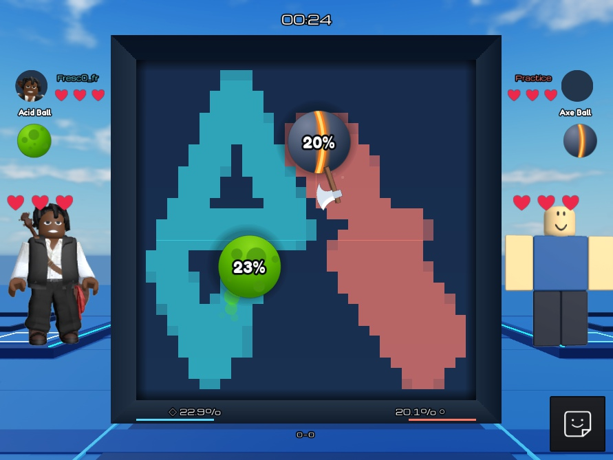

# Ball VS Space

A Roblox territory battler in development. Choose a ball, aim, then let the server simulate the round while each team claims space. The presentation is being reconstructed from the supplied Ball vs Ball reference before further differentiation.

**Current build: 0.3 presentation, local 1v1 and solo Practice.** Twelve ball appearances, authored icon/ball atlases, dedicated collection and store screens, responsive phone layouts and an interactive lobby sit over two authoritative territory kits. Territory, scoring, overtime and round flow work; 2v2, parties, additional abilities and durable progression remain future game work. See [BUILD_STATUS.md](BUILD_STATUS.md) for verification and [the backlog](game/docs/backlog.md) for remaining milestones.



## Get running

Install Git, [Roblox Studio](https://create.roblox.com/), PowerShell 7, and [Rokit 1.2.0](https://github.com/rojo-rbx/rokit/releases/tag/v1.2.0). Clone this repository, open a terminal at its root, then run:

```powershell
rokit install
pwsh -File game/tools/verify.ps1
```

Open `game/builds/BallVsSpace.rbxl` in Studio. Press **Play**, then **Practice**. Choose a ball, aim on the court and press **Lock Aim**. Territory is visible by default; the lobby gear can hide the overlay for reference comparisons. For a human match, start **Test → Server & Clients → 2 clients**, then click **Play** in each client.

The build script runs formatting, lint and strict type analysis, then generates `.rbxl` and `.rbxlx` files. Generated places are ignored by Git; source is canonical. GitHub Actions runs the same checks and attaches place builds to successful runs. Studio runtime and multiplayer checks are separate; CI does not claim to run Roblox.

## Work together

For UI work, start with the [frame/source guide](game/docs/ui-editing-guide.md) and [clickable screenshot map](game/docs/ui-map.html). The [starter replication skill](game/docs/skills/reference-ui-replication/SKILL.md) condenses the visual reconstruction process for future iterations.

Start with [CONTRIBUTING.md](CONTRIBUTING.md) and [partner onboarding](game/docs/partner-onboarding.md). The destination is [EkpoFresco/BallVsSpace](https://github.com/EkpoFresco/BallVsSpace); this checkout preserves the earlier game history on `main`. Actual push and collaborator status is recorded in BUILD_STATUS.

For live source sync:

```powershell
rojo serve game/default.project.json
```

Connect the Rojo Studio plugin to that server in your local BallVsSpace place. Keep scripts in `game/src/`; Studio-only edits are overwritten by source sync. Optional Studio MCP tools require Node.js 24 and the installed Studio MCP transport; see [toolchain notes](game/docs/toolchain-notes.md).

## Repository map

| Path | Purpose |
| --- | --- |
| `game/src/shared/` | Rules, grid, physics, protocol and shared types |
| `game/src/server/` | Authoritative matches, queues, replication and runtime tests |
| `game/src/client/` | Input, camera, territory, ball rendering and UI |
| `game/assets/runtime/` | Original runtime assets managed by Rojo |
| `game/assets/art/` | Editable original SVGs, published atlases and asset provenance |
| `game/default.project.json` | Canonical filesystem-to-Studio mapping |
| `game/tools/` | Builds, source sync, Studio QA and comparison tools |
| `game/docs/` | Architecture decisions, testing, visual gaps and onboarding |
| `game/test-evidence/` | Saved test results and curated screenshots |
| `Ball_VS_Space_Evidence/` | Untouched reference screenshots, notes and video |
| `BALL_VS_SPACE_RESEARCH_AND_BUILD_SPEC.md` | Full research and design contracts |
| `BUILD_STATUS.md` | Current state, evidence, failures and resume task |

Open [the presentation comparison](game/test-evidence/presentation-comparison.html) locally in a browser for eight reference/current pairs and four phone captures. GitHub displays its source; the references are included so it works after cloning. The [previous 0.2 comparison](game/test-evidence/replica-comparison.html) is retained. Images document the actual result; exact pixel identity and human acceptance are not claimed.

`START_HERE.md`, `RUN_PROMPT.txt`, `SETUP.md` and the transfer manifest describe the original research handoff. Their statements about an empty pack are historical; use this README and BUILD_STATUS for the implemented project. The `checks/` Python scripts validate research math, not the game runtime.

Game art is reconstructed with original vectors, code and primitives; reference evidence is kept separately. [Art regeneration and image delivery](game/assets/art/README.md) are documented. No project license has been selected. Public game release is a separate milestone from publishing this source repository.
