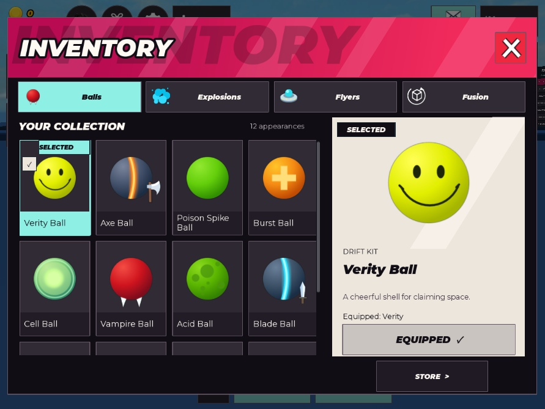

# Ball VS Space

A Roblox territory battler: choose a ball, aim, then compete for space as the server simulates the round. **Current build: action-v1 UI, 1v1 and solo Practice.** Twelve appearances share two ability kits. Human visual acceptance, physical-device testing, 2v2 and durable progression remain open.



**Play the saved game:** download [BallVsSpace.rbxl](game/places/BallVsSpace.rbxl), open it in Roblox Studio, press **Play / F5**, then **Practice**. This compact primary place includes the current scripts and game setup. Menus and the world are created during Play. Every verification build refreshes this file; CI rejects a saved place that differs from the source build.

## Find what you need

| I want to… | Start here |
| --- | --- |
| Build, run or work with a partner | [Development guide](CONTRIBUTING.md) |
| Edit UI or identify a frame | [UI guide](game/docs/ui/README.md) · [clickable map](game/docs/ui/map.html) |
| Compare the game with the reference | [Reference comparison](game/docs/ui/reference-comparison.html) |
| Share UI context in another chat | `node game/tools/build-ui-handoff.mjs` → `game/exports/UI_HANDOFF.zip` |
| Understand the code and rules | [Architecture](game/docs/architecture.md) |
| Run tests or assess validation | [Testing and review](game/docs/testing.md) · [evidence index](game/test-evidence/README.md) |
| Choose the next task | [Build status](BUILD_STATUS.md) · [backlog](game/docs/backlog.md) |

## Run locally

Install Git, PowerShell 7, Roblox Studio and Rokit. From the repository root:

```powershell
rokit install
pwsh -File game/tools/verify.ps1
```

Open `game/builds/BallVsSpace.rbxl`, press **Play**, then **Practice**. For 1v1, start two Studio clients and click Play in both. Source changes belong in `game/src/`; use `rojo serve game/default.project.json` for live sync.

## Repository layout

```text
game/
  src/             Canonical client, server and shared Luau
  assets/          Original artwork and runtime assets
  docs/            Architecture, testing, backlog, history and UI guide
  tools/           Build/export commands; studio/, qa/, art/, ci/, lib/, types/
  test-evidence/   Selected screenshots/results; earlier runs in one indexed archive
  places/         One current, ready-to-open binary place saved in Git
  builds/          Generated places (ignored)
  exports/         Generated UI folder/ZIP (ignored)
Ball_VS_Space_Evidence/   Untouched original research and references
.local/                  Ignored temporary work and recovery files
```

The root `START_HERE.md`, `RUN_PROMPT.txt`, `SETUP.md`, specification and transfer manifest are the **original research handoff**. Their empty-project statements are historical. Use the guides above for current development; [history](game/docs/history.md) preserves earlier implementation records. The [full specification](BALL_VS_SPACE_RESEARCH_AND_BUILD_SPEC.md) remains the design contract.

The source repository is [EkpoFresco/BallVsSpace](https://github.com/EkpoFresco/BallVsSpace). Runtime art is original; private reference source/physics were not recovered and pixel-perfect identity is not claimed. No project license has been selected. Roblox publication remains separate from source sharing.
