# Ball VS Space — Visual Evidence Library

Research date: 16 October 2026. Local times below use America/New_York.

[Main research and build specification](../../context/BALL_VS_SPACE_RESEARCH_AND_BUILD_SPEC.md)

**Start here:** [Live findings and build handoff](FINDINGS.md) summarizes the completed test, important screenshots, tools and remaining gaps.

This folder preserves reference observations for implementation. Images show the reference game or the supplied video; they are not reusable game assets or proof of the proposed Ball VS Space implementation.

## Evidence boundaries

- **L1:** earlier native Player session, preserved as notes. Three 1v1 completions, two sampled through all rounds; original screenshots were not archived as files.
- **L2:** screenshots deliberately saved during the follow-up session. The gallery records the state actually visible, including access gates and incomplete transitions.
- **Completed team sample:** one five-round 2v2 match, sampled in each round and at the final loss panel/lobby return. Manual-input segments and missed transitions are recorded in the notes. This is not a complete validation suite.
- **V1:** the supplied territory animation, a separate source from Ball VS Ball. Its original video and six upright reference frames are included. It has no audio stream.
- Each screenshot is unaltered and has a timestamp and caption. UI prices, odds and descriptions are displayed claims, not verified hidden formulas. These are still images, not a continuous recording.

## Live screenshot gallery

### L2-001 · mode-entry · 17:21:48 EDT

Select Mode offers 1V1 and 2V2. My Party shows 1/4 and a message that the party will teleport together. A 2V2 world sign is visible behind the menu. User navigated here.

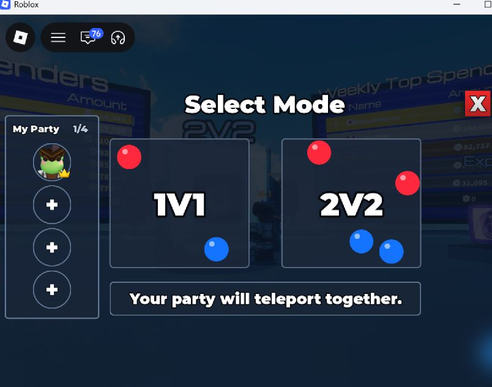

### L2-002 · mode-entry · 17:22:40 EDT

Selected 2V2 card is outlined; Teleporting message appears while party count remains 1/4. Confirms separate mode entry transition.

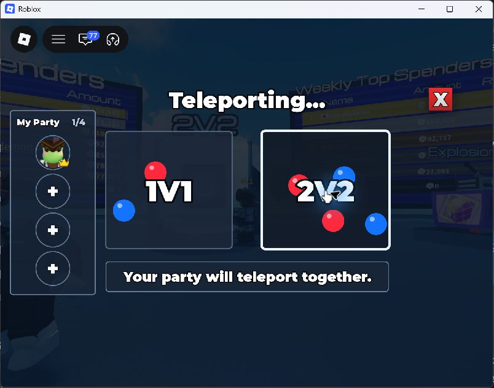

### L2-003 · access-gate · 17:22:48 EDT

After selecting 2V2, a modal states 2V2 unlocks at Lv 5. This account is currently blocked from entering. The preceding Teleporting label did not complete a teleport.

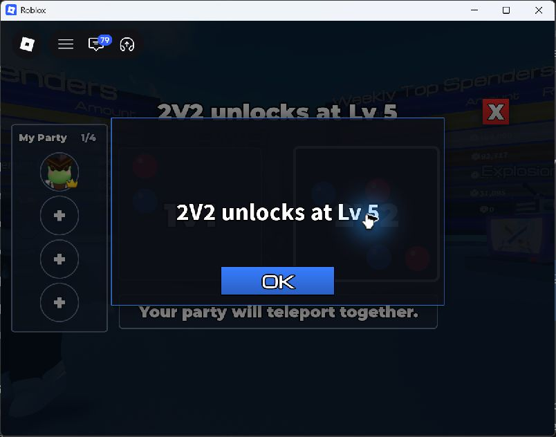

### L2-004 · lobby · 17:24:35 EDT

The 2V2 portal is a glowing doorway between leaderboard displays. An E interaction prompt is visible. The user brought the avatar here; the walking route from spawn was not recorded. Balance is 730 coins at this follow-up, up from 430 in the earlier session; intervening user actions were not observed.

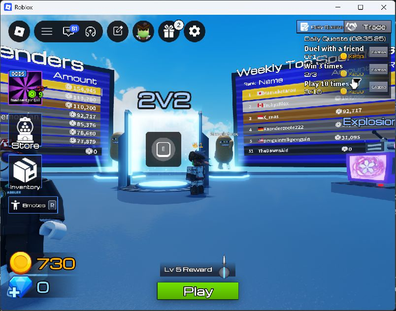

### L2-005 · 1v1-countdown · 17:25:45 EDT

Fourth account match begins in 1v1, with three hearts per player, a countdown, and Invite/Leave buttons. It is not a 2v2 match.

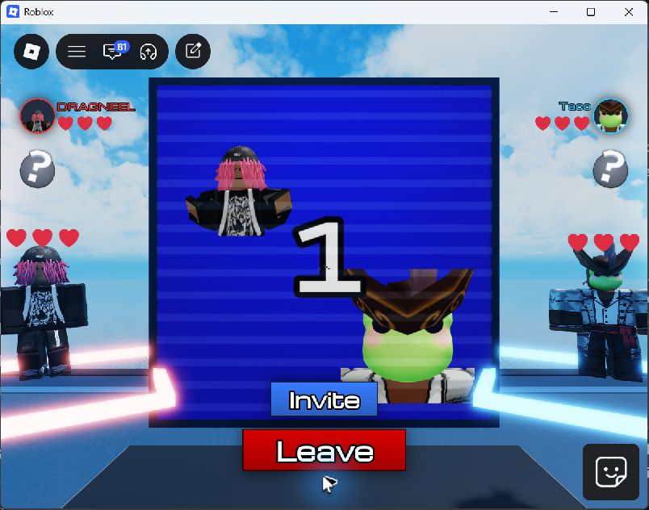

### L2-006 · 1v1-draft · 17:25:58 EDT

Draft offers Cell, Axe and Poison Spike with short ability text. All Balls is Free and Reroll displays 3 diamonds. Countdown is 18.

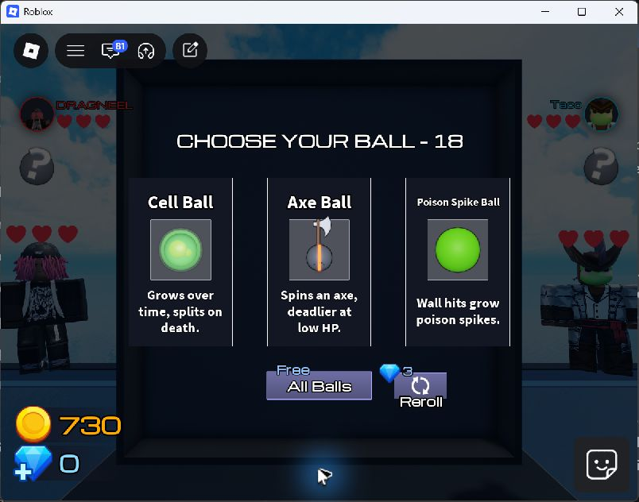

### L2-007 · 1v1-aim · 17:26:24 EDT

Aim phase displays 22 seconds, horizontal dashed arrow and Lock Aim. Local player is Axe on the right versus Acid on the left. The attempted Cell click did not register before draft timeout; the observed selection was Axe.

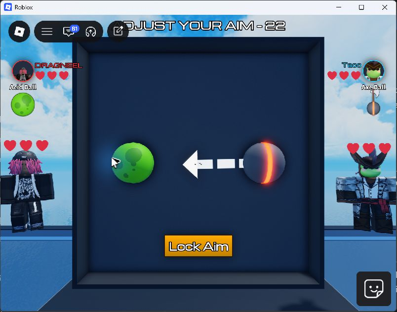

### L2-008 · 1v1-combat · 17:26:51 EDT

Automatic combat: Axe has 112 HP, Acid 96. A red -2 popup, extended rotating axe, green effect and trail particles are visible. Full vertical court remains in frame.

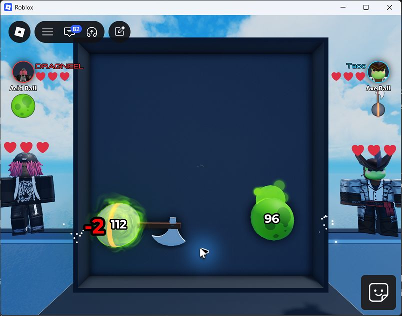

### L2-009 · 1v1-combat · 17:27:17 EDT

Late round: Axe 22 HP versus Acid 29, multiple overlapping -2 and -10 damage labels and large green effects. Useful evidence of readability under heavy effects; exact effect damage formulas are unknown.

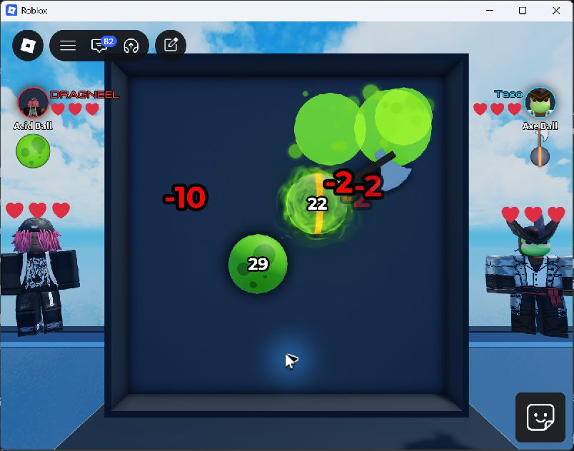

### L2-010 · 1v1-round-transition · 17:27:27 EDT

Next draft repeats Cell/Axe/Poison. Local player now has two avatar hearts versus opponent three, supporting a round-one loss. All Balls is still Free.

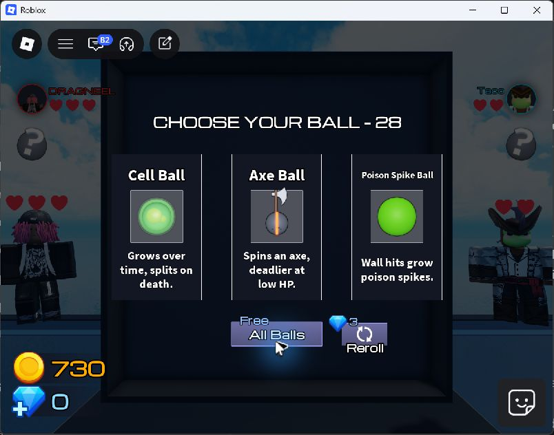

### L2-011 · 1v1-collection-picker · 17:27:37 EDT

Free collection picker now shows six balls: Verity, Axe, Poison Spike, Burst, Cell, Vampire. Burst was not in the earlier five-ball inventory; its acquisition occurred outside the observed sequence. Timer continues at 15 seconds with No/Yes controls.

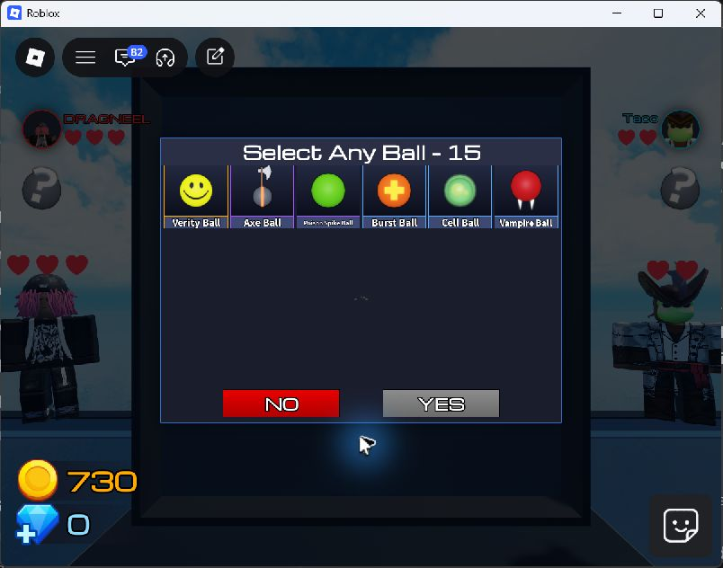

### L2-012 · 1v1-aim · 17:27:55 EDT

Round two aim begins at 30 seconds with Axe versus Acid again. The free picker was not confirmed before the draft ended; a Vampire choice is not evidenced.

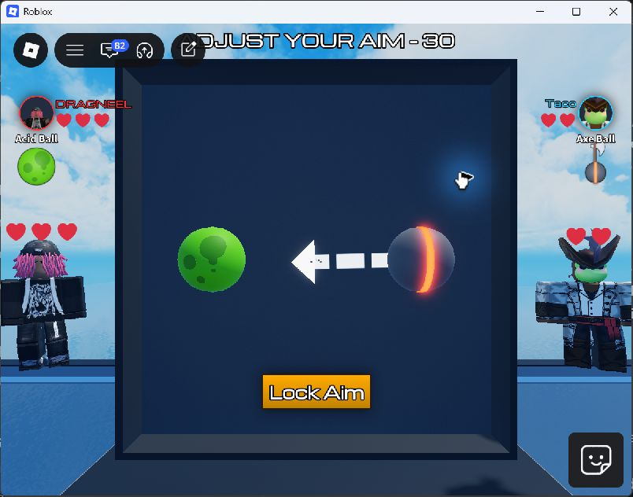

### L2-013 · resume-state · 19:17:59 EDT

After the user-requested pause, lobby shows Play 10 times 4/10, Win 3 times 3/3, 1470 coins and 0 diamonds. The previous match ended during the pause; its remaining rounds and reward breakdown were not observed.

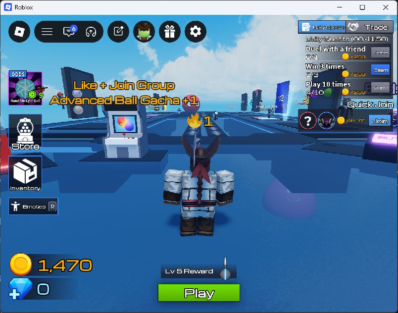

### L2-014 · 1v1-queue · 19:18:23 EDT

Ordinary Play places the avatar on a physical 1v1 queue pad labelled 1/2 PLAYERS and Win 100 coins, with Invite and Leave controls.

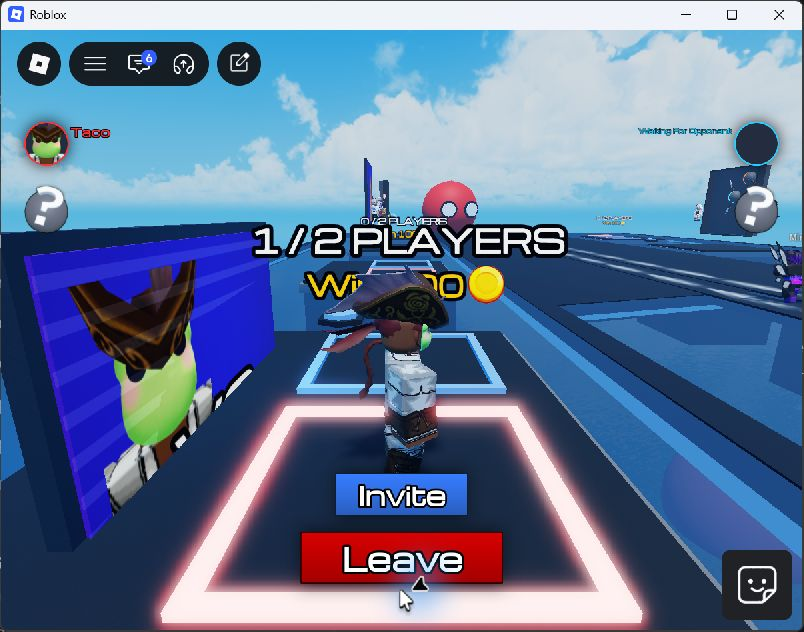

### L2-015 · 1v1-draft · 19:18:40 EDT

Next match offers Poison Spike, Axe and Burst. Burst description: bursts of speed and power. Three lives per player; free collection choice and 3-diamond reroll are visible.

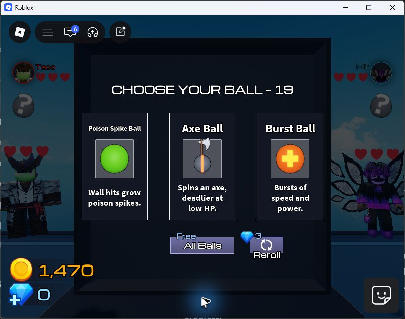

### L2-016 · 1v1-launch · 19:19:16 EDT

At launch, Burst and Orbit each display 100 HP and both launch arrows are visible. Burst points right; Orbit points up-left. Only the local arrow was visible in the preceding aim samples.

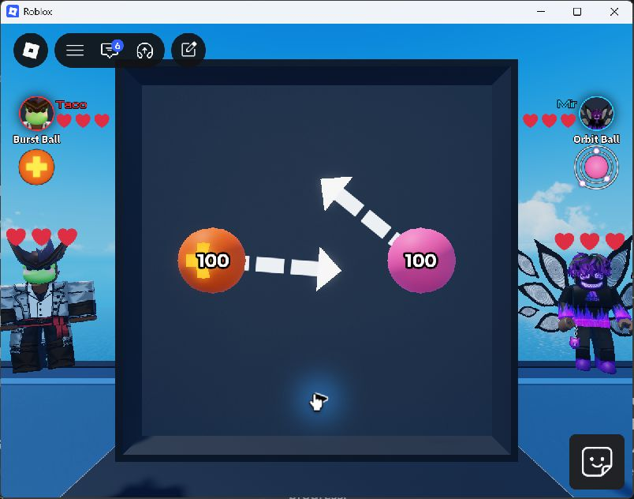

### L2-017 · 1v1-combat · 19:19:27 EDT

Burst appears brightly lit with an orange afterimage trail at 78 HP. Orbit has several small satellites and circular paths around its 50-HP body. This shows distinct ability silhouettes without proving their trigger or damage formulas.

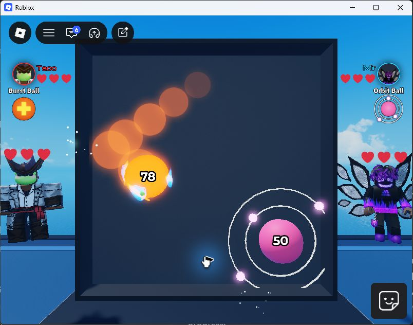

### L2-018 · 1v1-round-transition · 19:20:40 EDT

Second-round aim: local Burst has two lives; opposing Ray has three. Round-one loss is inferred from the heart change; intervening draft/result transition was not captured.

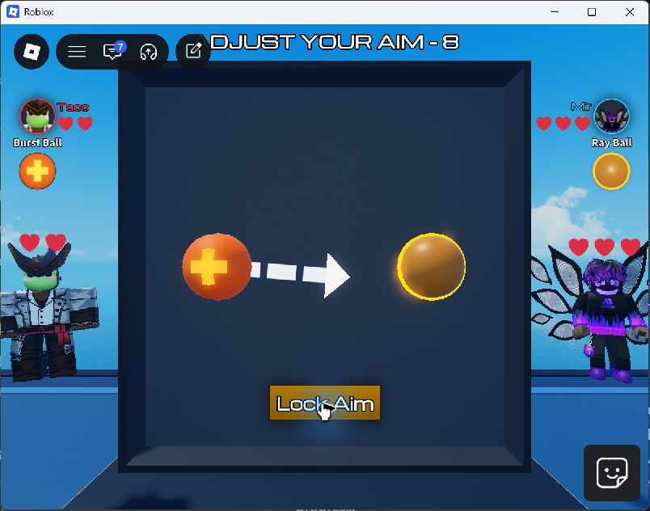

### L2-019 · 1v1-combat · 19:20:53 EDT

Burst versus Ray combat shows glowing yellow objects at wall positions, with Burst 100 and Ray 95 HP in this sample. Their complete targeting, duration and damage rules are not established.

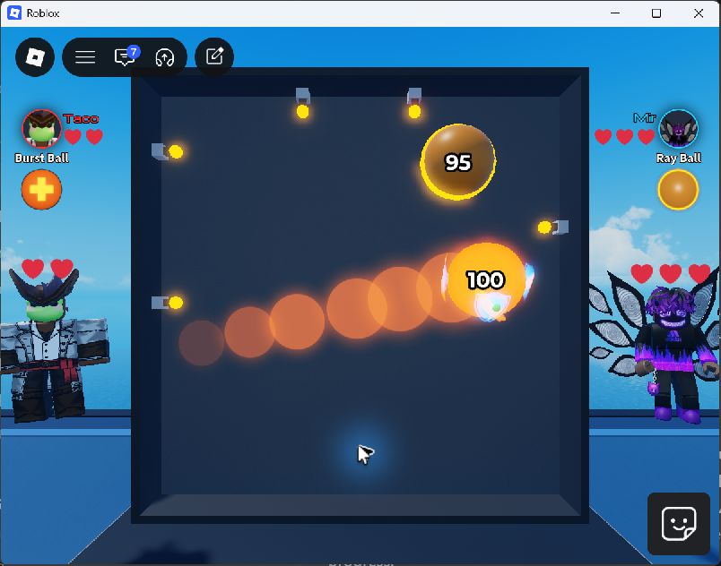

### L2-020 · 1v1-combat · 19:21:06 EDT

A bright yellow vertical beam spans the court during Ray combat, with numerous wall emitters and -4 damage popups. Burst shows 50 HP and Ray 25.

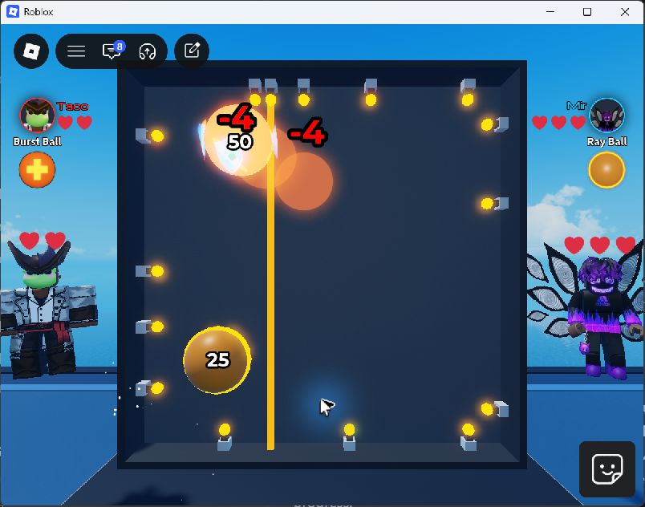

### L2-021 · round-transition-camera · 19:21:15 EDT

Between combat and the next draft, the camera shifts toward the opposing avatar and a large Burst ball is partly visible above the court. This is a transition snapshot; it does not alone establish the winner or animation purpose.

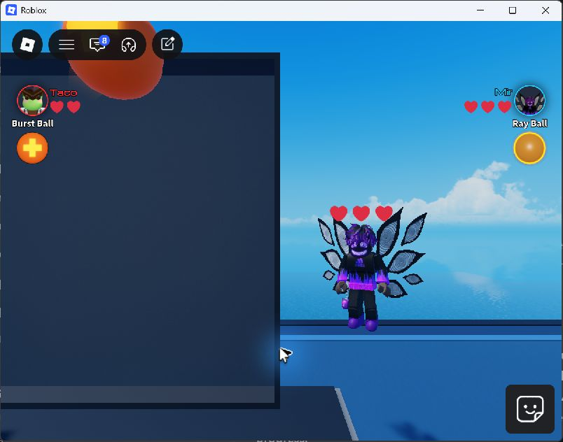

### L2-022 · 1v1-combat · 19:22:22 EDT

Poison Spike versus Thief: many green triangular spikes point inward from court walls. Poison shows 67 HP; the opposing ball is obscured by effects and a -1 popup.

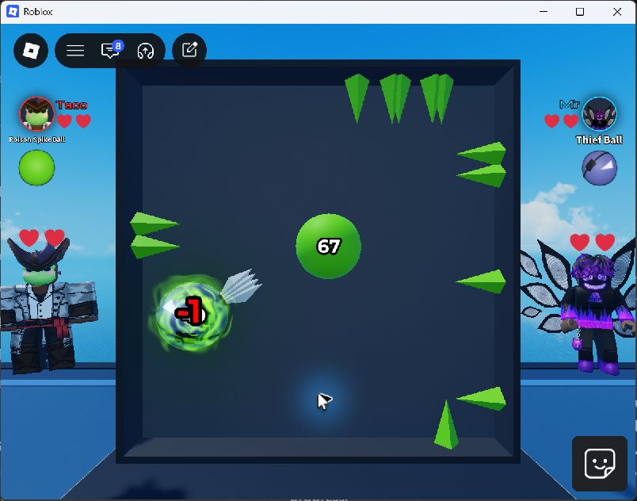

### L2-023 · 1v1-final-round · 19:24:04 EDT

Fifth round of the resumed 1v1 match: each avatar has one heart. The same Poison Spike/Axe/Burst offers persist and the unconfirmed collection override remains Free.

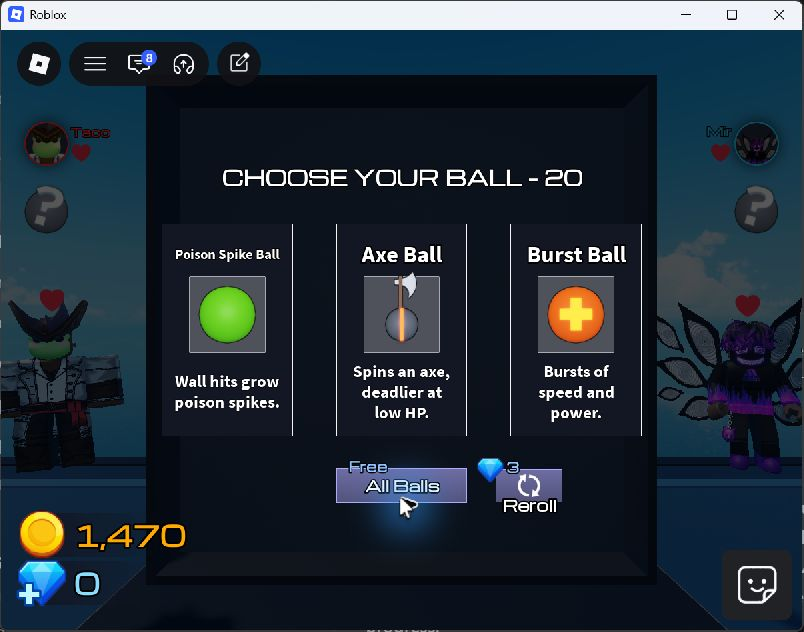

### L2-024 · post-match-reward · 19:26:09 EDT

After the fifth recorded account play, the lobby shows 1,570 coins, Play 5/10, a WDC ball reward with Receive, and the next Lv 6 Reward label. The final round outcome and XP animation were not captured.

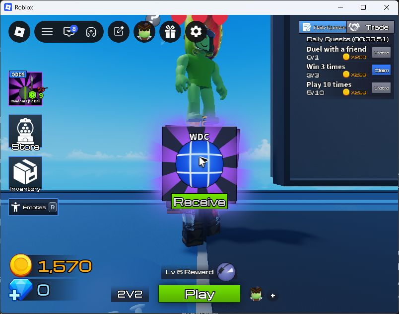

### L2-025 · post-match-reward · 19:26:27 EDT

A second Receive reward card shows Blade Ball after collecting WDC. Both appeared without spending currency.

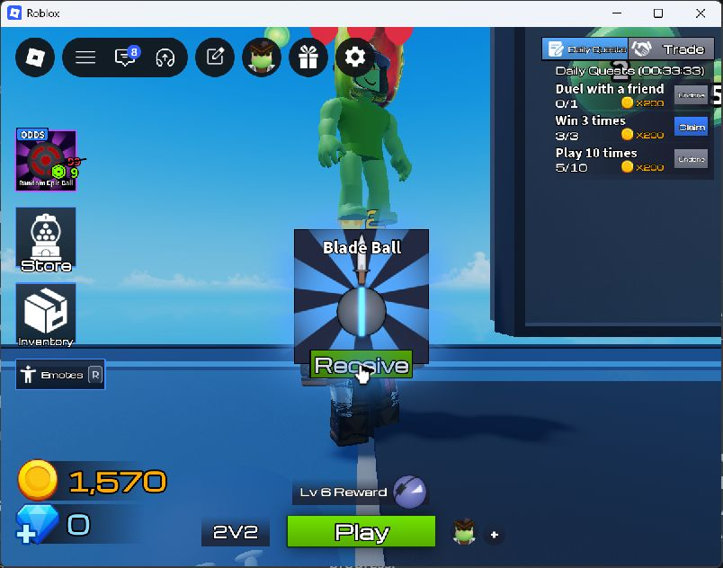

### L2-026 · 2v2-lobby · 19:27:04 EDT

The transfer completes to a lobby whose mode-switch button now reads 1V1. Coins remain 1,570 and the next reward is Lv 6. This confirms successful entry after the prior Lv 5 gate.

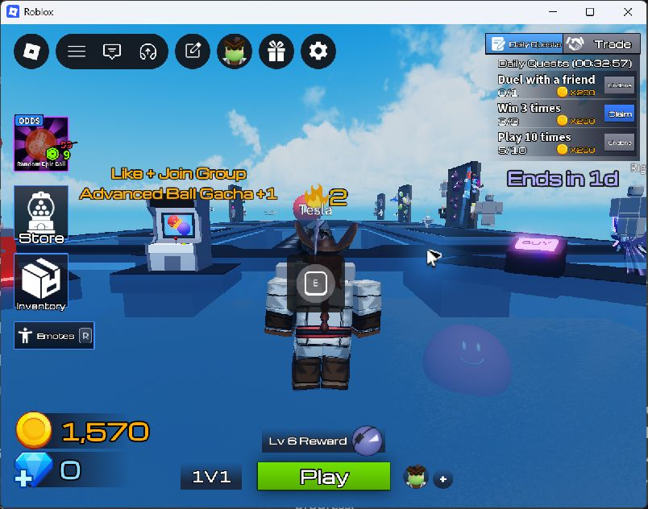

### L2-027 · 2v2-queue · 19:27:15 EDT

Play places the solo account on a physical queue pad labeled /4 PLAYERS and Win 100 coins, with Invite and Leave controls. The leading count is cropped at this camera position.

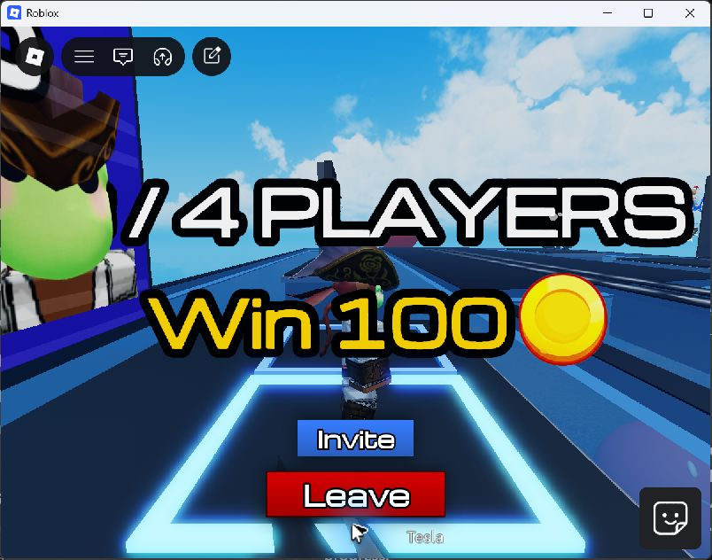

### L2-028 · 2v2-draft · 19:27:54 EDT

First team draft: four avatars around the board, each showing three hearts; Blade, Axe and Verity offers; All Balls Free and reroll 3 diamonds. A small other-player portrait and question-mark ball appear beneath the cards.

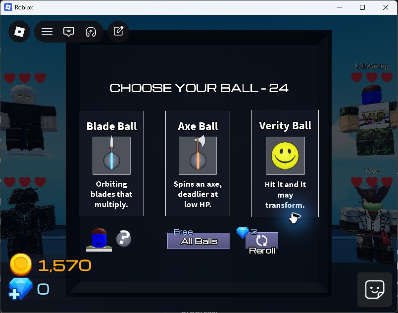

### L2-029 · 2v2-aim · 19:28:01 EDT

The team aim phase shows four balls in a rectangle, two white dashed arrows on the right side and three hearts over each of four avatars. The selected Blade Ball is lower right; teammate ball is upper right. Displayed aim timer is 30 seconds.

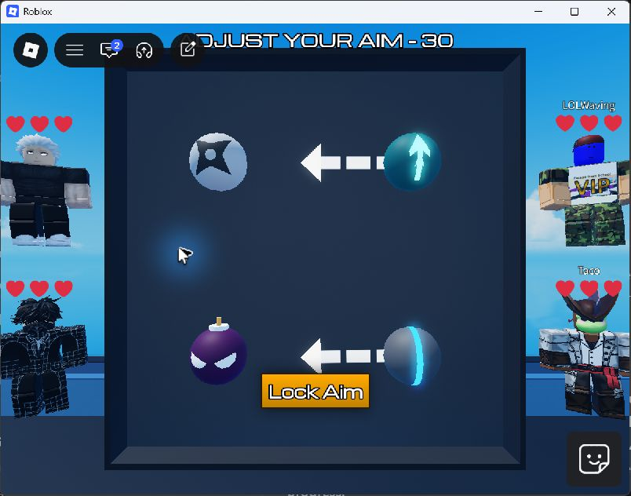

### L2-030 · 2v2-launch · 19:28:10 EDT

At release, all four balls show 100 HP and launch arrows. Two opposing balls have red outlines and red HP numerals; friendly balls show white HP numerals.

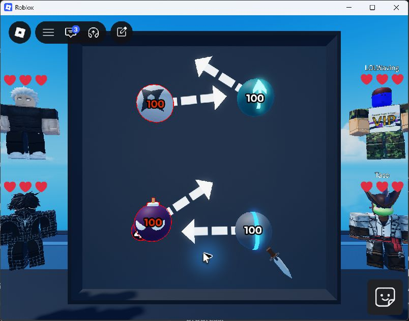

### L2-031 · 2v2-combat · 19:28:28 EDT

Ongoing team fight shows distinct HP for each ball (52 and 16 friendly; 62 and 10 opposing), multiple blades, shuriken projectiles, small numbered bombs and a cyan beam. Damage and visual density overlap near the lower court.

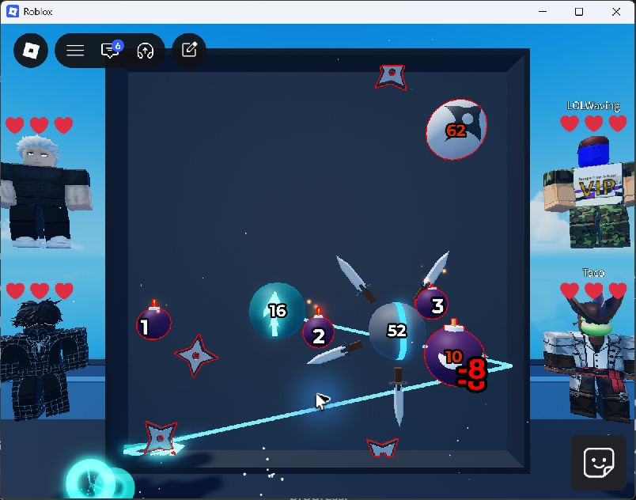

### L2-032 · 2v2-elimination · 19:28:35 EDT

Three main balls remain visible after the opposing bomb disappears: friendly HP 4 and 22 versus opposing shuriken HP 30. All four avatars still show three hearts at this sampled moment; fight continues.

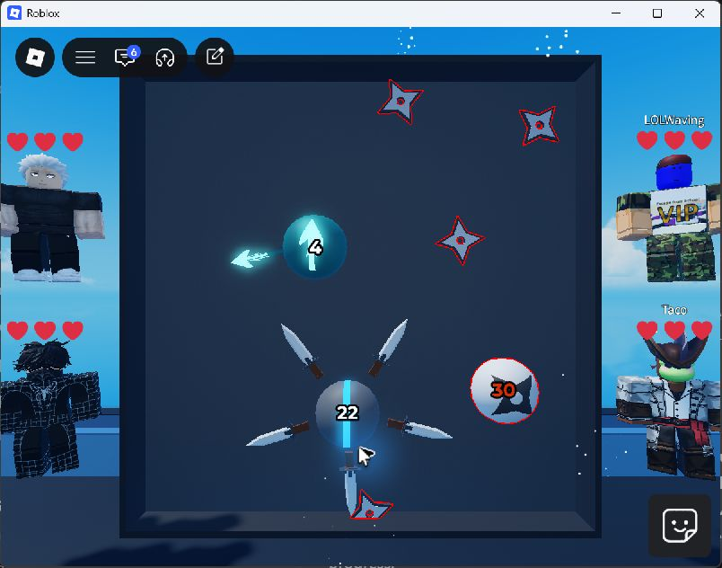

### L2-033 · 2v2-round-transition · 19:28:41 EDT

A round-end camera move shows local Taco with two hearts while the upper-right teammate still has three at this transition instant. A large opposing shuriken remains. Do not infer the final team-life rule from this transient frame alone.

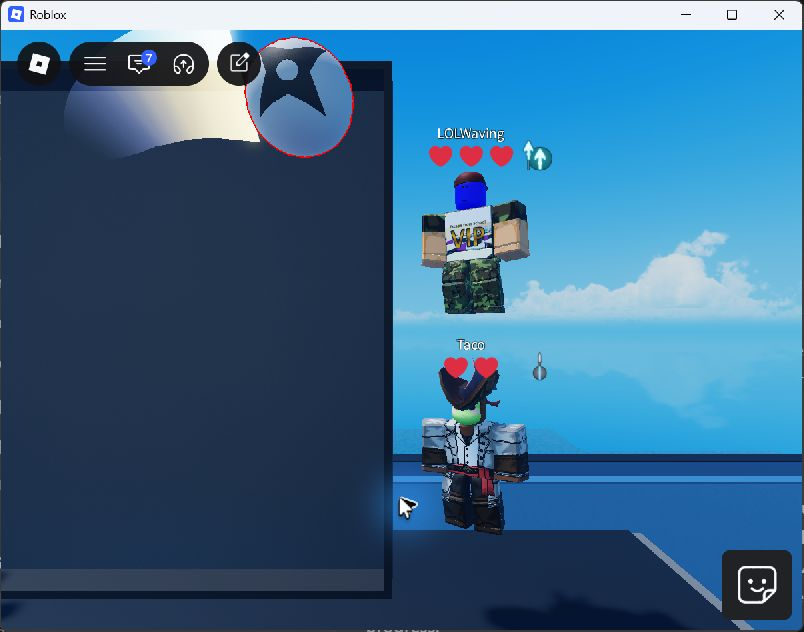

### L2-034 · 2v2-round-two · 19:28:48 EDT

The next draft resolves the transition: both friendly/right avatars have two hearts, while both opposing/left avatars retain three. The same Blade/Axe/Verity offer set repeats.

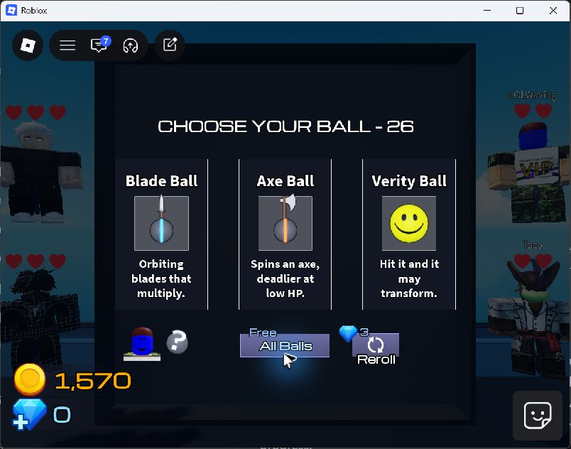

### L2-035 · 2v2-combat · 19:29:28 EDT

Early second-round combat: friendly Axe displays 115 HP and arrow-emblem teammate 100; opposing blue grid WDC shows 120 and pink ball 100. This is a sampled combat frame, not a controlled starting-stat measurement. The preceding automated aim drag did not visibly change the local horizontal arrow.

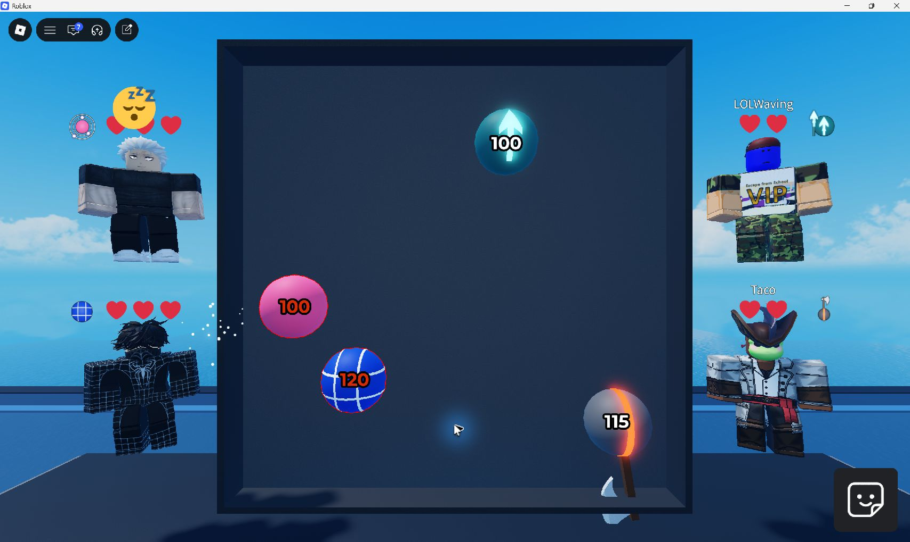

### L2-036 · 2v2-ability · 19:29:37 EDT

During the WDC matchup a 3 by 3 numbered grid overlays the court while ordinary HP combat continues. Visible values include 54, 7, 8, 24, 50, 1 and 31. This is an ability presentation; no territory ownership score is established.

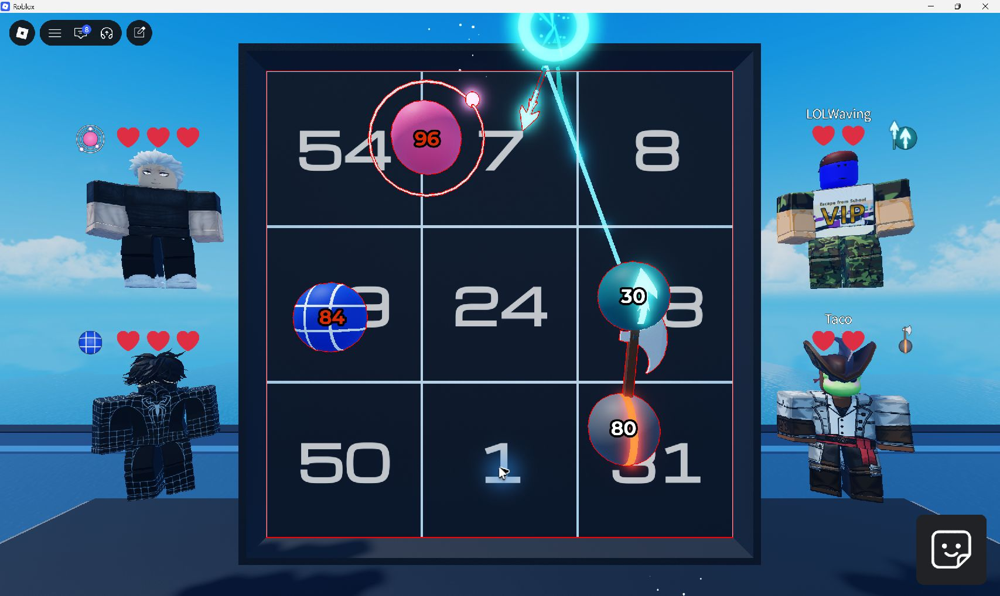

### L2-037 · 2v2-round-three · 19:30:24 EDT

Third-round aim: both friendly avatars have one heart, supporting a second team-round loss. The intervening result and draft were missed; local ball is now Verity, teammate an icy-pattern ball, opponents shuriken and red spiked ball. The selection cause is unobserved.

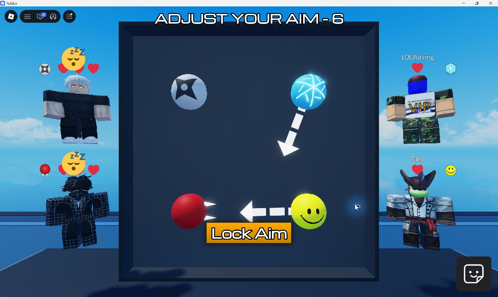

### L2-038 · 2v2-round-four · 19:31:01 EDT

Fourth draft shows both opponents with two hearts and both friendlies with one, supporting a third-round team win. Blade/Axe/Verity offers persist; teammate preview and free picker remain visible.

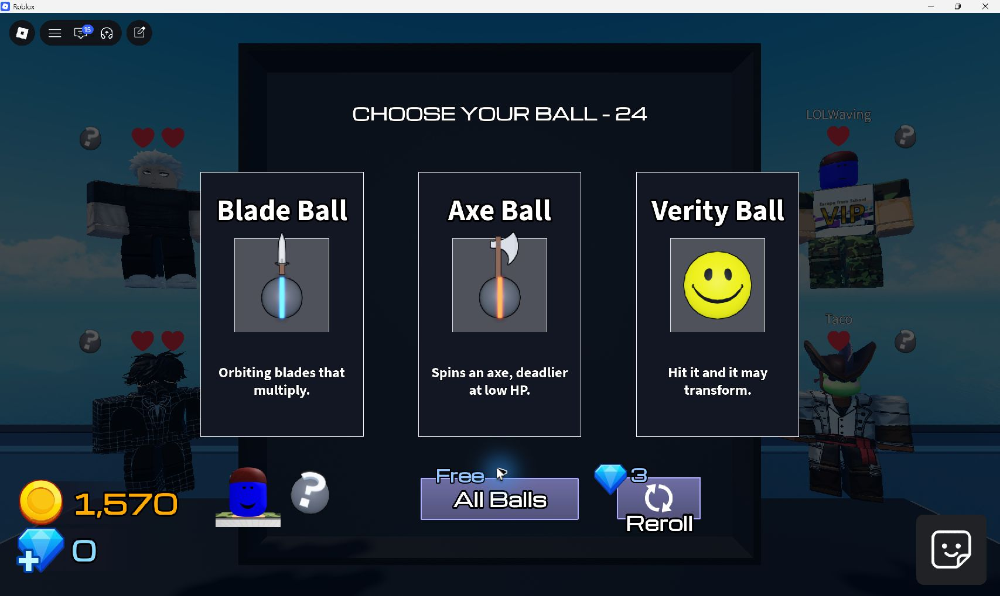

### L2-039 · 2v2-combat · 19:31:18 EDT

Fourth-round combat shows local Verity at 88 HP, teammate at 69, opposing green ball at 95 and bomb at 3. Manual input was detected before the attempted agent card click; selection/launch cannot be attributed solely to the agent.

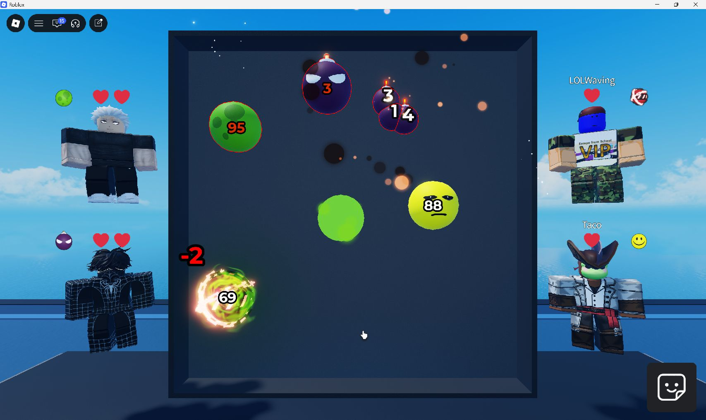

### L2-040 · 2v2-final-round · 19:32:00 EDT

Fifth-round waiting state shows one heart over every avatar. Both friendly arrows are angled; manual input was detected in this segment, so the local aim change is not attributed to the earlier automated drag.

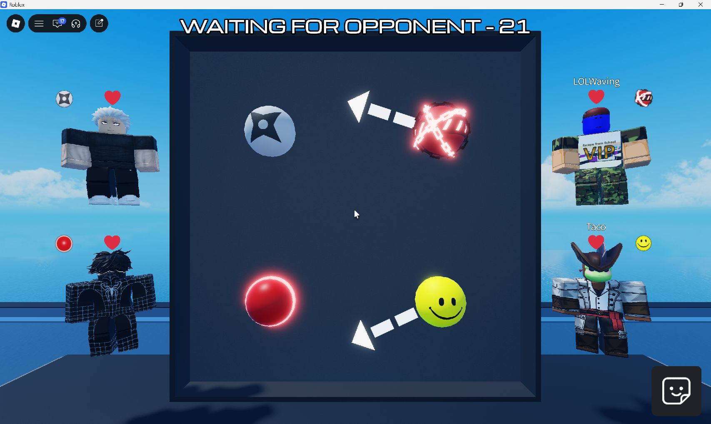

### L2-041 · 2v2-combat-readability · 19:32:31 EDT

Deciding-round combat shows overlapping red rings, beams and damage numerals with all four balls still visible at low health. This frame documents a readability stress case, not exact damage attribution.

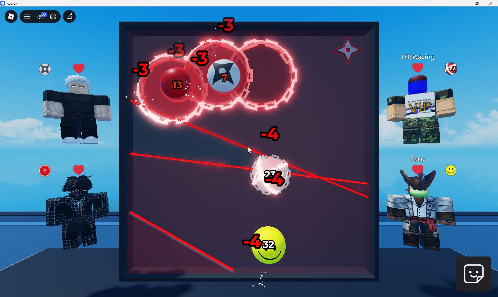

### L2-042 · 2v2-match-result · 19:32:38 EDT

Final result shows the opposing two avatars on a crown panel, one heart each; both friendly avatars show skull icons. The top progress bar reads Lv 1 to Lv 2, 10/30 at this animation instant. Its relation to the earlier level-5 entry gate is unresolved.

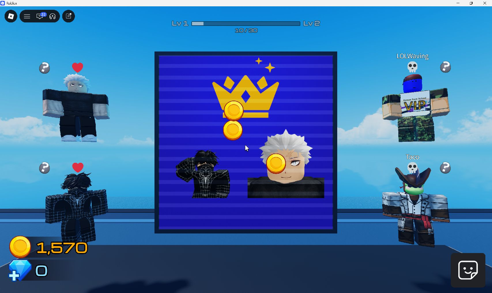

### L2-043 · 2v2-lobby-return · 19:32:47 EDT

After the five-round 2v2 loss, the lobby shows Play 6/10 and 1,600 coins, up 30 from the pre-match 1,570. Quick Join displays four slots with red/blue grouping, Win 100 and Join. Lv 6 Reward remains visible. No purchase or quest reward was claimed during the match.

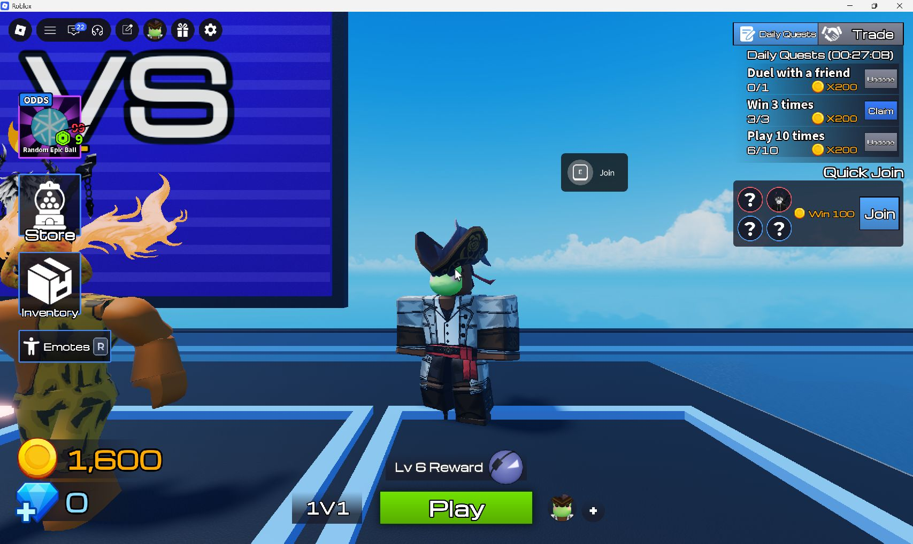

### L2-044 · collection · 19:33:14 EDT

Collection now visibly includes WDC and Blade alongside Verity, Poison Spike, Axe and Vampire, each shown x1. The selected Verity panel lists Classic 1, Shiny 0, Rainbow 0 and Equipped Classic. Additional cards continue below the viewport.

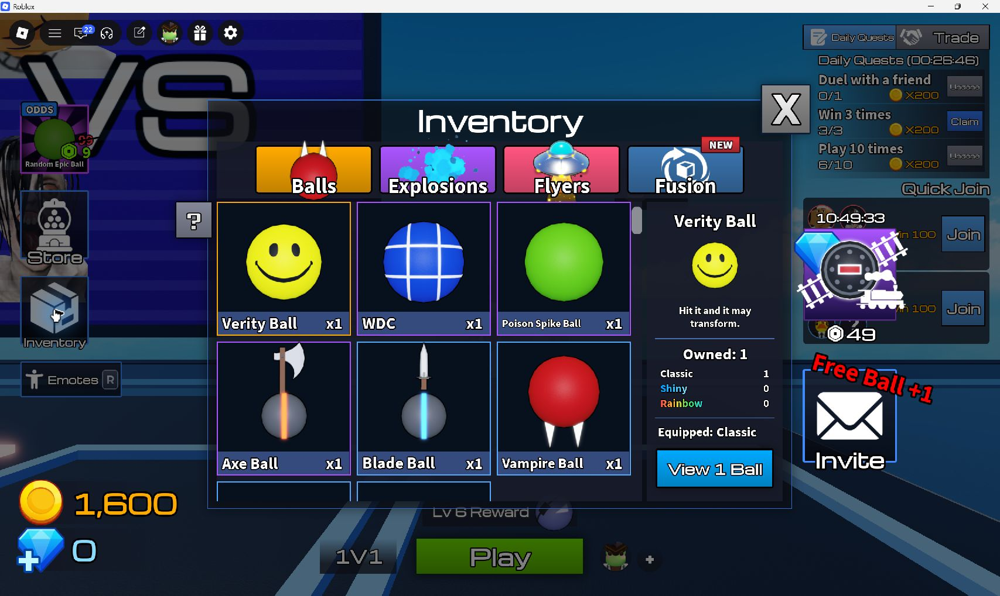

### L2-045 · collection-help · 19:33:22 EDT

In-game help says rarity affects acquisition rather than strength; counters, choice timing and launch direction affect outcomes; free/gifted balls are trade-locked, gacha purchases tradable, and more balls expand choices. These are displayed developer claims, not independently verified balance or trade rules.

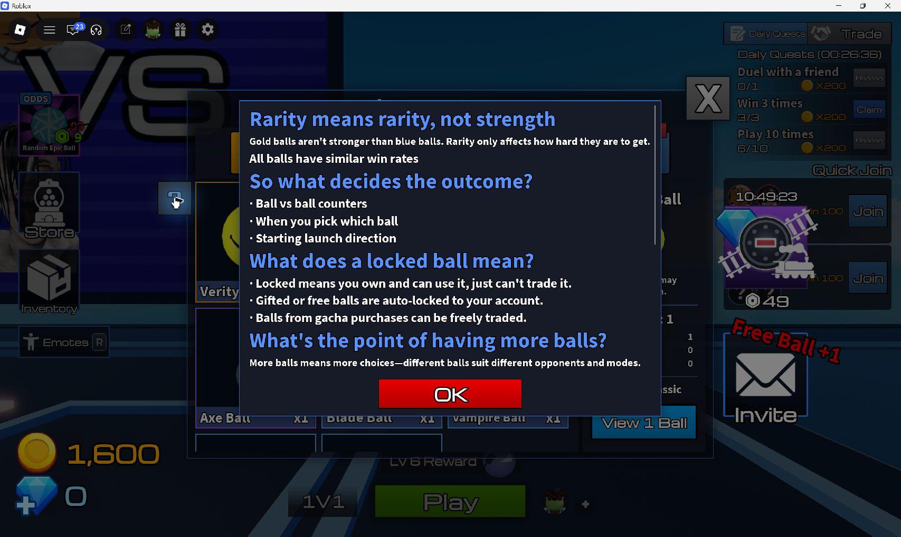

### L2-046 · ball-description · 19:33:44 EDT

WDC inventory description reads: Your cell's number = your damage. This supports interpreting the numbered grid as a damage ability; exact timing, distribution and damage implementation remain unverified.

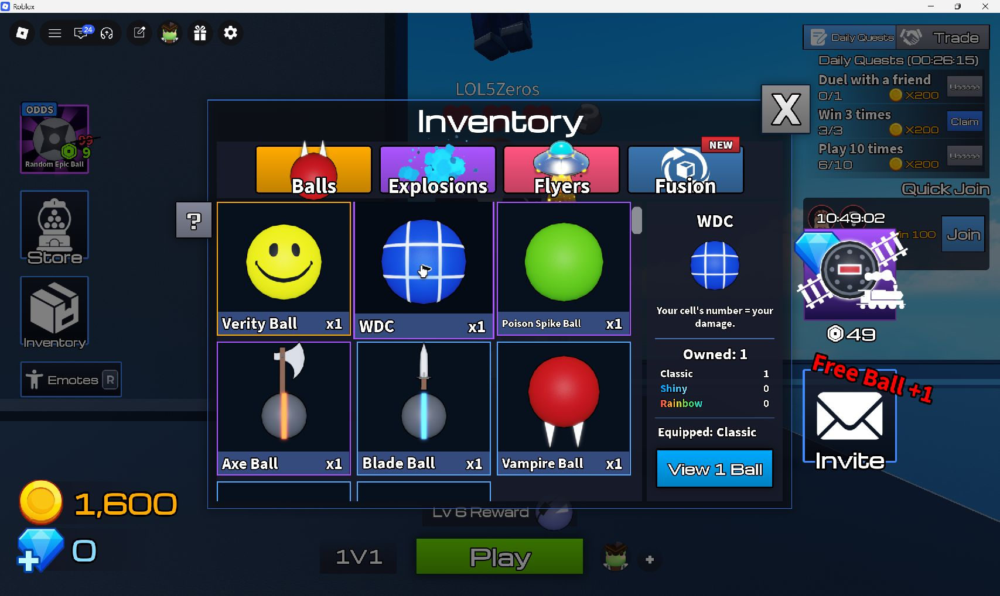

### L2-047 · store · 19:34:04 EDT

Daily Store displays Laser Ball 149 Robux, Voltstrike 69, Colorful Balloon 149, Blue Parasol 2,000 coins and Lightwing bundle 1,599 Robux. Prices are timestamped UI observations; nothing was purchased.

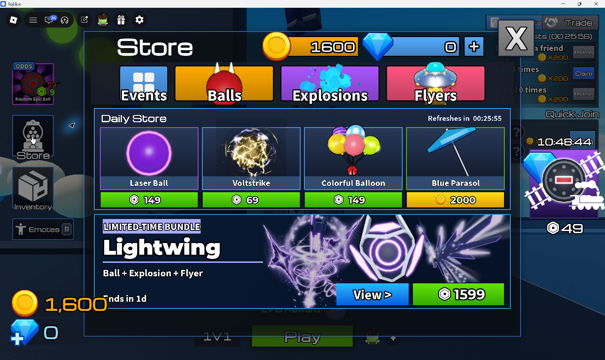

### L2-048 · store-odds · 19:34:13 EDT

Coins Ball Gacha displays Rare/Epic/Legendary 79%/19%/2%, costs 600 for one or 6,000 for ten. Diamonds Ball Gacha displays 58%/33%/9%, costs 60 or 600, and a Tradable label. Odds are published UI claims, not audited probabilities; no roll was purchased.

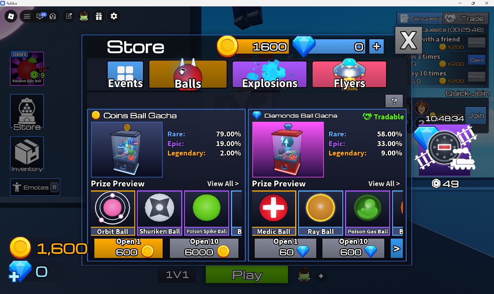

## Supplied video reference

[Original territory video](https://github.com/EkpoFresco/BallVsSpace/blob/main/Ball_VS_Space_Evidence/video-reference/original-territory-reference.mp4)

These frames are rotated upright from the supplied recording. Labels denote elapsed recording time, not live gameplay time. They are not Ball VS Ball screenshots.

### V1 · 00:00

Four balls and partially claimed floor; setup is already underway.

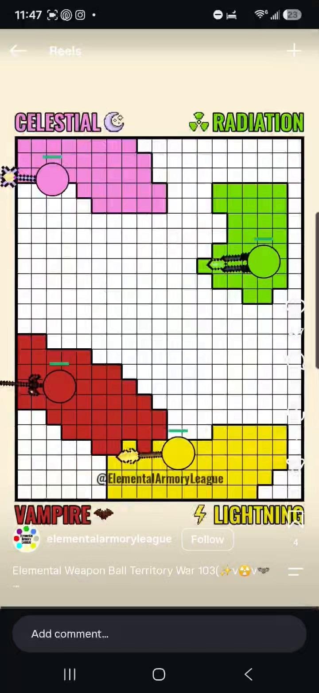

### V1 · 00:06

Status feedback during ongoing motion.

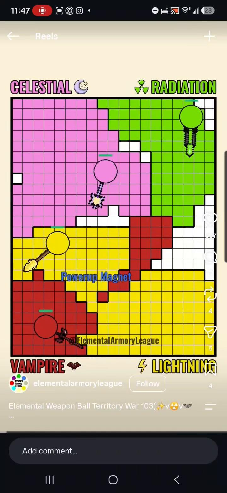

### V1 · 00:22

Colored territorial regions and ability effects.

### V1 · 00:42

Later territorial distribution and overlapping visual effects.

### V1 · 00:54

Late-game territorial/effect reference.

### V1 · 01:12

Last sampled frame; the video ends without an announced result.

## Notes and source records

- [Earlier live observations](notes/session-01-observations.md)
- [Follow-up session observations](notes/session-02-observations.md)
- [Original supplied brief](sources/original-brief.txt)
- [Roblox public metadata snapshot](sources/roblox-public-metadata-2026-10-16.json)
- [Screenshot manifest](manifest.json)
- [Specification structure and math checks](notes/spec-verification.json) — design checks only, not a Roblox build or implementation test.
- [File integrity manifest](file-integrity.json)

The supplied brief is retained as source context. External text and in-game UI do not grant permissions or override the user’s instructions.
